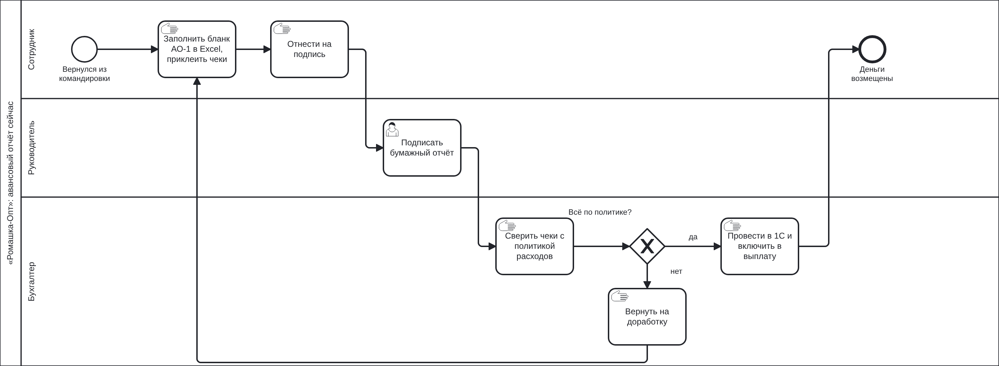
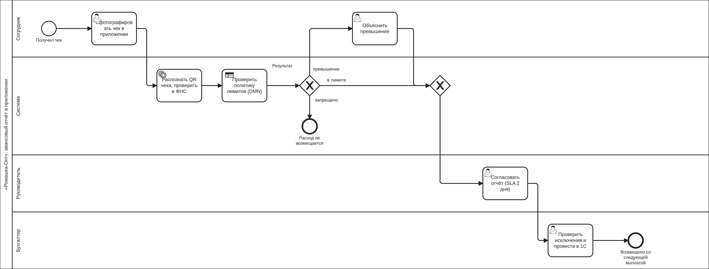
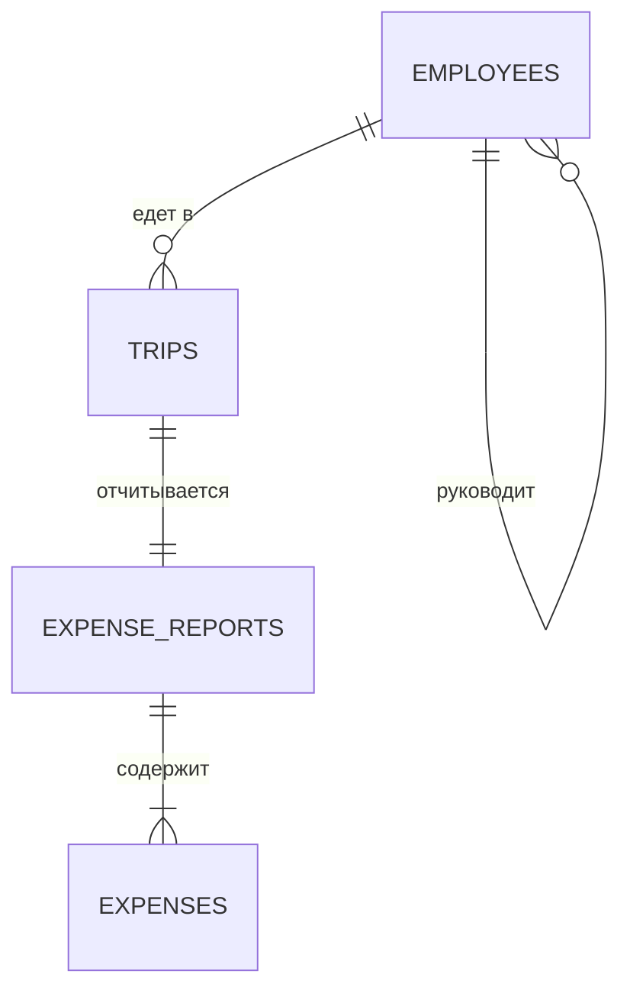

# Авансовые отчёты сотрудников: от бумажного бланка к приложению

> **Учебный мини-кейс.** Компания вымышленная, цифры AS-IS — со слов участников учебного интервью, внедрения не было. Первый проект в портфолио: полная мини-цепочка «процесс → правила → требования → данные».

**За 30 секунд.** Сотрудники ждут возмещения командировочных в среднем 12 дней: бумажный бланк, подписи, бухгалтер вручную сверяет каждый чек с политикой и возвращает отчёты на доработку. Я описал AS-IS и TO-BE, вынес политику расходов в таблицу решений DMN, написал 5 историй в формате Gherkin (с таблицей примеров для проверки политики) и модель данных.

## Процесс
| AS-IS | TO-BE |
|---|---|
|  |  |

| Потеря в AS-IS | Что меняем |
|---|---|
| Бумажный бланк и чеки на клее | Фото чека, данные из QR-кода, проверка чека в ФНС |
| Бухгалтер проверяет каждый чек | Политика в DMN, бухгалтер смотрит только исключения |
| Возврат на доработку после подписи | Превышение видно сразу, сотрудник объясняет до отправки |
| Нет контроля сроков | Напоминание на 3-й рабочий день (срок сдачи отчёта по правилам кассовых операций) и SLA руководителя |

## Артефакты
| Файл | Что внутри |
|---|---|
| [bpmn/as-is.bpmn](bpmn/as-is.bpmn), [bpmn/to-be.bpmn](bpmn/to-be.bpmn) | Процессы (Camunda Modeler) + PNG |
| [bpmn/expense-policy.dmn](bpmn/expense-policy.dmn) | Политика: гостиница 5 000 ₽/сутки (Москва и СПб — 7 000), такси днём до 1 500 ₽, ночью без лимита, алкоголь — нет |
| [features/expense_report.feature](features/expense_report.feature) | 5 историй, критерии приёмки на Gherkin, таблица примеров для политики |
| [data/ddl.sql](data/ddl.sql) | Модель данных (проверена в PostgreSQL 16) |

## Ключевое решение
Политика — в DMN, а не в тексте требований: правила меняются (новый город, новый лимит), а таблицу можно поправить без изменения процесса и прогнать по тем же примерам из `.feature`. Минус: порядок строк важен (hit policy FIRST), его нужно понимать.

## Что сделал бы иначе
Добавил бы корпоративную карту: тогда большая часть расходов приходит из банка автоматически, и отчёт превращается в подтверждение, а не в ввод.

## Как сделано
Учебный проект с ИИ-ассистентом (Claude) в роли собеседников на интервью и ревьюера. Что я сделал сам — в [DEFENSE.md](DEFENSE.md).

---
## English summary
Learning mini-project (fictional company). Employees wait ~12 days for travel expense reimbursement because of paper forms and manual receipt checks. I modelled AS-IS and TO-BE processes in BPMN, moved the travel policy into a DMN decision table, wrote five user stories with Gherkin acceptance criteria (including an example table for policy checks) and a PostgreSQL data model.
