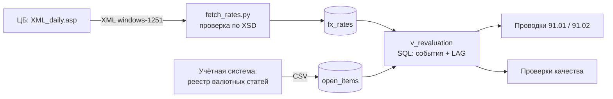

# Курсы ЦБ и валютная переоценка на конец месяца

> **Учебный проект.** Компания ООО «Василёк-Импорт» вымышленная, реестр долгов синтетический, курсы — открытые данные Банка России, внедрения не было.
> Роль: бизнес-аналитик (правила и требования) с элементами системного анализа. Как сделано и где помогал ИИ — в конце.

**За 30 секунд.** Импортёр с долгами в юанях, евро и долларах переоценивал их в Excel и ошибался: переоценивал авансы, брал курс не на ту дату, забывал разницу при погашении. Я формализовал 8 бизнес-правил по ПБУ 3/2006, написал скрипт, который забирает курсы из XML-сервиса ЦБ и проверяет ответ по XSD, и SQL-расчёт курсовых разниц с проводками. На данных сентября–октября 2026 расчёт дал **+7,19 млн ₽** курсовых разниц (рубль укрепился, долг поставщикам подешевел), а ошибка «переоценили авансы» стоила бы **119 тыс. ₽** искажения прибыли. Расчёт сверен независимой реализацией на pandas: 30 из 30 строк совпали до копейки.

**Главные артефакты:** [Бизнес-правила](docs/01_rules.md) · [Истории с Gherkin](docs/02_user_stories.md) · [Скрипт курсов ЦБ](scripts/fetch_rates.py) · [SQL переоценки](sql/02_revaluation.sql)

## Навигация
| Раздел | Где |
|---|---|
| Проблема, правила BR-01…BR-08, проводки, пример на калькуляторе | [docs/01_rules.md](docs/01_rules.md) |
| 3 пользовательские истории, критерии приёмки, НФТ | [docs/02_user_stories.md](docs/02_user_stories.md) |
| Скрипт «курсы ЦБ → CSV», схема XSD, образцы ответа ЦБ | [scripts/fetch_rates.py](scripts/fetch_rates.py), [data/schema/ValCurs.xsd](data/schema/ValCurs.xsd), [data/cbr_xml/](data/cbr_xml/) |
| Модель данных и SQL | [data/ddl.sql](data/ddl.sql), [sql/](sql/) |
| Проверка расчёта на pandas | [tests/check_revaluation.py](tests/check_revaluation.py) |
| Источники и лицензии | [data/SOURCES.md](data/SOURCES.md) |
| Гайд защиты (для себя) | [DEFENSE.md](DEFENSE.md) |

## Как работает


## Курсы ЦБ, которые использованы
| Дата | USD | EUR | CNY |
|---|---|---|---|
| 15.09.2026 | 84,3363 | 97,7626 | 12,5353 |
| 30.09.2026 | 84,4283 | 96,0625 | 12,5764 |
| 07.10.2026 | 85,7116 | 96,0313 | 12,7984 |
| 22.10.2026 | 81,9739 | 91,9337 | 12,2806 |
| 31.10.2026 (суббота) | 80,5573 | 89,6603 | 12,0873 |

## Результаты (из запуска `run_all.sh`)
| Запрос | Бизнес-вопрос | Результат |
|---|---|---|
| [01_rate_on_date](sql/01_rate_on_date.sql) | Какой курс взять на выходной? | на 01.11 (вс) — курс 31.10; запрос показывает и «дырки» в загрузке |
| [02_revaluation](sql/02_revaluation.sql) | Какая разница по каждому документу? | 30 событий по 26 денежным статьям |
| [03_postings_summary](sql/03_postings_summary.sql) | Какие проводки и итог? | сентябрь **+45 243 ₽**, октябрь **+7 149 241 ₽** (из них при погашении −274 451 ₽) |
| [04_data_quality](sql/04_data_quality.sql) | Можно ли закрывать месяц? | 4 проверки = 0; 3 аванса показаны как «не переоценивается» |

Почему в октябре такая большая сумма: открытых долгов поставщикам на 9,2 млн CNY, а юань подешевел с 12,80 до 12,09 ₽. Рублёвая оценка долга упала — это доход.

## Ключевые решения
- **Курс «действующий на дату», а не «ровно на дату»** (BR-03): иначе расчёт падает на выходных. Цена — нужна проверка, что курс не устарел из-за упавшей загрузки (`sql/04`, порог 3 дня).
- **Проверка ответа ЦБ по XSD**: если формат поменяется, загрузка остановится с ошибкой, а не запишет мусор.
- **Расчёт как цепочка событий с `LAG`**: одна логика для переоценки и погашения, легко добавить новую отчётную дату.

## Как сделано
- Первая версия собрана как учебный проект вместе с ИИ-ассистентом (Claude): черновики правил, генерация данных, ревью SQL.
- Что я разобрал и проверил сам — в [DEFENSE.md](DEFENSE.md), раздел «Как сделано».
- Инструменты: Python (pandas, lxml), PostgreSQL 16, Mermaid.

### Как запустить
```bash
pip install pandas lxml requests
createdb fx
psql -d fx -f data/ddl.sql
python scripts/fetch_rates.py          # офлайн из data/cbr_xml/; с --live скачает с cbr.ru
python data/generate_items.py          # пересоздаст реестр (seed фиксирован)
psql -d fx -f data/load.sql            # из корня репозитория
psql -d fx -f sql/02_revaluation.sql
python tests/check_revaluation.py      # сверка SQL с pandas
# или всё сразу: bash run_all.sh
```

**Что не проверено живым запросом:** cbr.ru из среды сборки был недоступен, поэтому образцы ответов ЦБ собраны по формату сервиса, а значения курсов переписаны с агрегатора. Подробно — в [data/SOURCES.md](data/SOURCES.md).

---
## English summary
Learning project (fictional importer, synthetic ledger, open Bank of Russia FX rates). The accountants revalued foreign-currency payables and receivables in Excel at month end and made recurring mistakes: revaluing prepayments, using the wrong date's rate, missing FX differences on settlement. I formalised 8 business rules based on Russian accounting standard PBU 3/2006, wrote a Python script that pulls official rates from the Bank of Russia XML service and validates each response against an XSD, and a PostgreSQL calculation (CTE + LATERAL + LAG) that produces per-document FX differences and journal entries. On September–October 2026 data the result is +7.19M RUB (the rouble strengthened), and an independent pandas implementation matches all 30 rows to the kopeck. The live call to cbr.ru was not verified from the build environment; see data/SOURCES.md.
