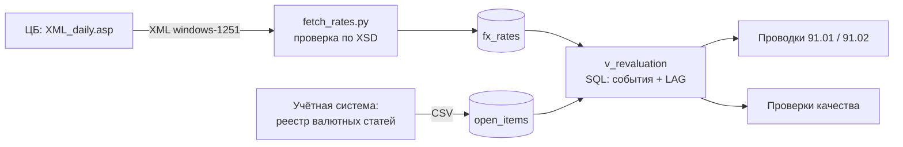

# 1. Контекст и бизнес-правила переоценки

## Проблема
ООО «Василёк-Импорт» (учебная компания) закупает товары в Китае и Европе и продаёт часть товара за рубеж. На конец месяца бухгалтер вручную переоценивает валютные долги в Excel: копирует курсы с сайта ЦБ, ищет открытые документы, считает разницу. Типичные ошибки из интервью-легенды:
- переоценили авансы (их переоценивать нельзя) — на данных октября это искажает прибыль на **119 149 ₽**;
- взяли курс не на ту дату (31.10.2026 — суббота, бухгалтер взял пятничный курс «на всякий случай»);
- забыли курсовую разницу при погашении долга внутри месяца.

**Цель:** расчёт переоценки за 15 минут вместо ~3 часов, без ручного копирования курсов, с проверками перед закрытием месяца.
**Вне рамок:** налоговый учёт отдельно не считаем (с 2015 года для монетарных статей он в основном совпадает с бухгалтерским, отличие — по авансам; это вопрос к главбуху), валютные кредиты, учёт в условных единицах.

## Как работает решение

## Бизнес-правила
| ID | Правило | Откуда |
|---|---|---|
| BR-01 | Монетарные статьи в валюте (долги покупателей и поставщикам, деньги на валютном счёте) пересчитываются в рубли на дату операции и на **последнее число каждого месяца** | ПБУ 3/2006, п. 4, 7 |
| BR-02 | **Авансы выданные и полученные не переоцениваются**: они учитываются по курсу на дату платежа, потому что будут погашены товаром, а не деньгами | ПБУ 3/2006, п. 10 |
| BR-03 | Курс — официальный курс ЦБ, **действующий на дату**: последний установленный с датой ≤ нужной даты. Курс, установленный в рабочий день, действует со следующего календарного дня до следующего установления, поэтому на выходные и праздники действует последний установленный курс. В ответе XML дата курса — атрибут `Date`, она может отличаться от запрошенной | Порядок установления курсов ЦБ; проверка `sql/01` |
| BR-04 | Курсовая разница = сумма в валюте × (курс на дату события − курс предыдущего события). По активу рост курса — доход, по обязательству рост курса — расход | ПБУ 3/2006, п. 3, 13 |
| BR-05 | При погашении долга курсовая разница считается от курса последней переоценки (или признания), а не от исходного курса | ПБУ 3/2006, п. 7 |
| BR-06 | Если долг погашен в отчётную дату, переоценку на эту дату не делаем — считаем только разницу при погашении (иначе разница посчитается дважды) | Внутреннее правило расчёта |
| BR-07 | Сумма округляется до копейки по каждой статье; итог по счёту = сумма округлённых строк | Сверка с учётной системой |
| BR-08 | Курс за 1 единицу = `Value / Nominal` (ЦБ публикует, например, 100 казахстанских тенге) | Формат XML ЦБ |

## Проводки
| Ситуация | Проводка |
|---|---|
| Курс вырос, долг покупателя (62.21) | Дт 62.21 Кт 91.01 — доход |
| Курс упал, долг покупателя | Дт 91.02 Кт 62.21 — расход |
| Курс вырос, долг поставщику (60.21) | Дт 91.02 Кт 60.21 — расход |
| Курс упал, долг поставщику | Дт 60.21 Кт 91.01 — доход |
| Авансы 60.22, 62.22 | проводок нет (BR-02) |

## Пример на калькуляторе
Долг поставщику 100 000 CNY признан 15.09.2026 по курсу 12,5353 ₽. На 30.09.2026 курс 12,5764 ₽.
Разница = 100 000 × (12,5764 − 12,5353) = **4 110 ₽**. Курс вырос, это обязательство → расход: Дт 91.02 Кт 60.21 — 4 110 ₽. Тот же пример зашит в тест `tests/check_revaluation.py`.

## Открытые вопросы к главбуху
1. Нужен ли отдельный расчёт для налогового учёта по авансам (ст. 271, 272 НК)?
2. Переоцениваем ли остатки на валютных счетах (52) этим же расчётом или их считает банк-клиент?
3. Что делать с частичными оплатами — делить документ на части? (сейчас: только полное погашение, см. CR-1 в DEFENSE.md)
