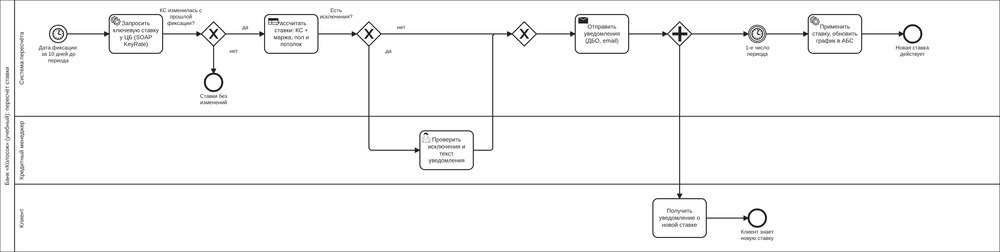
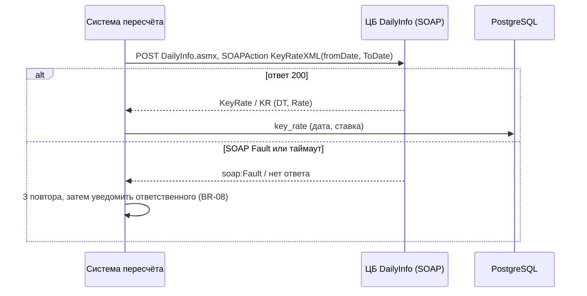

# Ключевая ставка ЦБ и пересчёт плавающих кредитов

> **Учебный проект.** Банк «Колосок» вымышленный, кредитный портфель синтетический, ключевая ставка — открытые данные Банка России, внедрения не было.
> Роль: бизнес-аналитик (правила, процесс, требования) с элементами системного анализа. Как сделано и где помогал ИИ — в конце.

**За 30 секунд.** После каждого решения ЦБ банк вручную пересчитывал ставки по 80 кредитам «КС + маржа» и путался в датах, поле и потолке. Я формализовал 8 бизнес-правил (дата фиксации за 10 дней до периода, пол и потолок, уведомление за 7 дней), нарисовал процесс пересчёта в BPMN, собрал SOAP-запрос к сервису ЦБ `KeyRateXML` и скрипт разбора ответа, а SQL посчитал влияние на портфель. Ставка ЦБ упала с 21 % до 14 %: средневзвешенная ставка портфеля снизилась с 24,0 % до 17,9 %, к концу 2026 года 15 кредитов из 75 «стоят на полу», и пол добавил банку **9,4 млн ₽** дохода за 2026 год. Сценарий «КС 13 %» — минус 2,3 млн ₽ в месяц и уже 26 кредитов на полу.

**Главные артефакты:** [Бизнес-правила и истории](docs/01_rules.md) · [BPMN](bpmn/rate-reset.png) · [SOAP-запрос](soap/keyrate-request.xml) · [SQL влияния](sql/03_portfolio_impact.sql)



## Навигация
| Раздел | Где |
|---|---|
| Проблема, правила BR-01…BR-08, пример, 4 истории, открытые вопросы | [docs/01_rules.md](docs/01_rules.md) |
| Процесс пересчёта и уведомления | [bpmn/rate-reset.bpmn](bpmn/rate-reset.bpmn), [PNG](bpmn/rate-reset.png) |
| SOAP: конверт, curl, SoapUI, WSDL | [soap/](soap/), [soap/soapui.md](soap/soapui.md) |
| Скрипт разбора ответа ЦБ | [scripts/fetch_key_rate.py](scripts/fetch_key_rate.py) |
| Модель данных и SQL | [data/ddl.sql](data/ddl.sql), [sql/](sql/) |
| Источники | [data/SOURCES.md](data/SOURCES.md) |
| Гайд защиты (для себя) | [DEFENSE.md](DEFENSE.md) |

## Как устроен обмен с ЦБ


## Результаты (из запуска `run_all.sh`)
| Запрос | Бизнес-вопрос | Результат |
|---|---|---|
| [01_key_rate_changes](sql/01_key_rate_changes.sql) | Когда менялась КС и что попало в фиксацию? | 10 снижений с 21 % до 14 % за 2025–2026 |
| [02_loan_rates](sql/02_loan_rates.sql) | Ставка и проценты по каждому договору | представление на 24 месяца; пример КЛ-2420 упирается в пол 19 % с марта 2026 |
| [03_portfolio_impact](sql/03_portfolio_impact.sql) | Как изменились доход и ставки? | средневзв. ставка 23,96 % (янв 2025) → 17,90 % (дек 2026); пол +9,4 млн ₽ за 2026; потолок −2,6 млн ₽ за 2025 |
| [04_notifications](sql/04_notifications.sql) | Кого уведомить на август 2026? | 61 клиент до 25.07; у 15 ставка не меняется из-за пола |
| [05_what_if](sql/05_what_if.sql) | Что если КС = 13 %? | доход в месяц 52,9 → 50,6 млн ₽ (−2,3); на полу 15 → 26 договоров |

Доход по годам (524,5 млн ₽ в 2025 и 769,7 млн ₽ в 2026) растёт потому, что портфель вырос с 26 до 77 кредитов, а не из-за ставок. Для оценки решений ЦБ смотрим на средневзвешенную ставку и эффект пола и потолка.

## Ключевые решения
- **Фиксация за 10 дней до периода** (BR-03): успеваем проверить исключения и уведомить клиента за 7 дней. Цена — новая КС приходит в ставку с задержкой до месяца.
- **KeyRateXML, а не KeyRate**: чистый XML вместо громоздкого .NET DataSet, разбор в 5 строк.
- **Без ручного ввода КС** (BR-08): если ЦБ недоступен — пересчёта нет, это безопаснее, чем ошибка в ставке у 80 клиентов.

## Как сделано
- Первая версия собрана как учебный проект вместе с ИИ-ассистентом (Claude): черновики правил, генерация портфеля, ревью SQL.
- Что я разобрал и проверил сам — в [DEFENSE.md](DEFENSE.md), раздел «Как сделано».
- Инструменты: SoapUI / curl, Python (pandas, lxml), PostgreSQL 16, Camunda Modeler (BPMN), Mermaid.

### Как запустить
```bash
pip install pandas lxml requests
python scripts/fetch_key_rate.py        # офлайн из soap/keyrate-response.sample.xml; --live — запрос к ЦБ
python data/generate_portfolio.py       # портфель (seed фиксирован)
createdb loans
psql -d loans -f data/ddl.sql -f data/load.sql     # из корня репозитория
psql -d loans -f sql/02_loan_rates.sql -f sql/03_portfolio_impact.sql
# или всё сразу: bash run_all.sh
```
`.bpmn` открывается в [Camunda Modeler](https://camunda.com/download/modeler/) или на [demo.bpmn.io](https://demo.bpmn.io).

**Что не проверено живым запросом:** cbr.ru из среды сборки был недоступен. SOAP-конверт собран по описанию сервиса, ответ — образец в том же формате; история ставки 2025–2026 сверена по новостям, 2023–2024 — нет. Подробно — в [data/SOURCES.md](data/SOURCES.md).

---
## English summary
Learning project (fictional bank, synthetic loan book, open Bank of Russia key rate data). The bank repriced 80 floating-rate SME loans (key rate + margin) by hand after every central bank decision, with errors around fixing dates, floors and caps. I formalised 8 business rules (10-day lookback fixing, floor/cap, 7-day client notice, no manual rate entry), modelled the repricing and notification process in BPMN, built the SOAP request to the Bank of Russia DailyInfo `KeyRateXML` method with a Python parser, and measured portfolio impact in PostgreSQL. As the key rate fell from 21% to 14%, the weighted average loan rate dropped from 24.0% to 17.9%, 15 of 75 loans hit their floor, and floors added 9.4M RUB of interest income in 2026. The live SOAP call was not verified from the build environment; see data/SOURCES.md.
