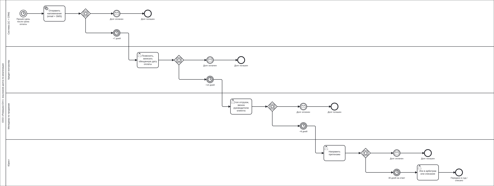
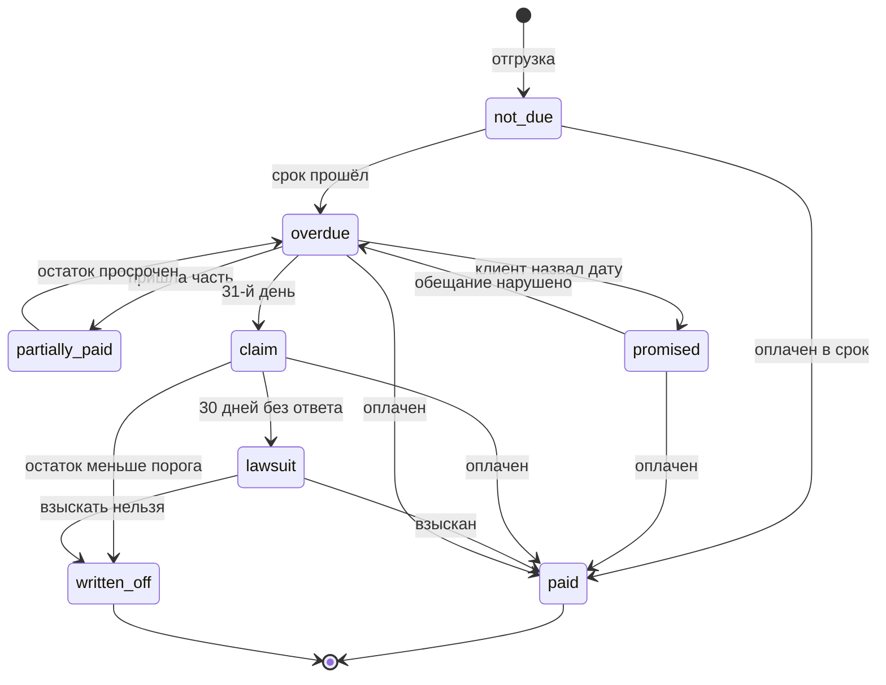
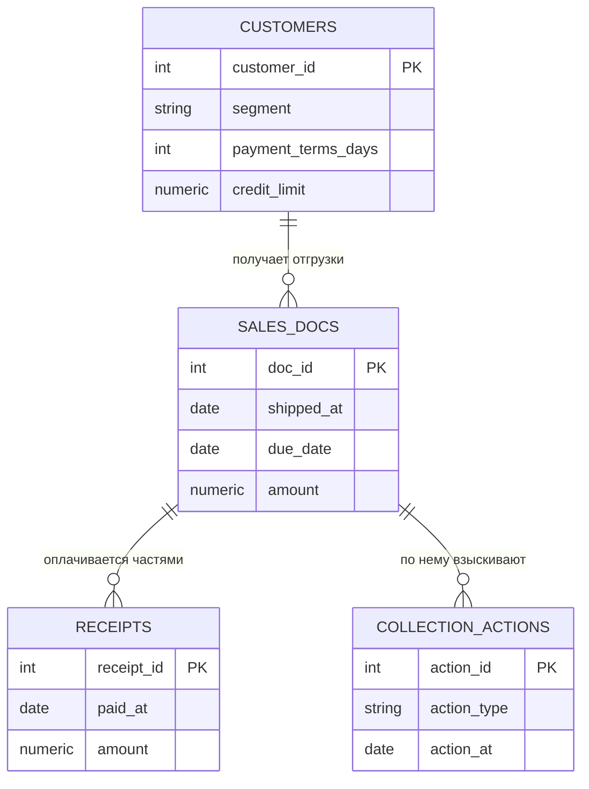

# Дебиторка: напоминания, aging и DSO

> **Учебный проект.** Компания ООО «Ромашка-Опт» и её клиенты вымышленные, данные синтетические, внедрения не было.
> Роль: бизнес-аналитик. Мини-кейс: процесс + SQL-аналитика. Как сделано и где помогал ИИ — в разделе «Как сделано».

**За 30 секунд.** Оптовая компания отгружает товар 40 клиентам с отсрочкой, а напоминания о долге шлют «когда вспомнят»: только **30 %** просроченных документов получили хоть какое-то действие, медиана до первого — **11 дней**. DSO за 3 месяца вырос с **46,7 до 55,0 дня**, у клиентов лежит **≈11,1 млн ₽** сверх договорных сроков. Я посчитал aging и DSO на SQL, нашёл через `LAG` 5 клиентов, у которых опоздание выросло на 26–29 дней (ранний сигнал), и спроектировал процесс с таймерами и эскалацией: напоминание → звонок → стоп отгрузок → претензия → иск.

**Главные артефакты:** [BPMN с таймерами](bpmn/collection-to-be.png) · [Состояния долга](uml/debt-states.puml) · [Правила и истории](docs/requirements.md) · [7 SQL-запросов](sql/)



## Навигация
| Раздел | Где |
|---|---|
| Контекст, цель, бизнес-правила BR-01…08, истории, edge cases | [docs/requirements.md](docs/requirements.md) |
| Процесс TO-BE (BPMN, Camunda Modeler) | [bpmn/collection-to-be.bpmn](bpmn/collection-to-be.bpmn) |
| Диаграмма состояний долга | ниже и [uml/debt-states.puml](uml/debt-states.puml) |
| Схема данных и генератор | [data/ddl.sql](data/ddl.sql), [data/generate_data.py](data/generate_data.py) |
| SQL-аналитика | [sql/](sql/) |
| Гайд защиты (для себя) | [DEFENSE.md](DEFENSE.md) |

## Процесс: что меняется
| | AS-IS | TO-BE |
|---|---|---|
| Первое напоминание | вручную, у 30 % просрочек, медиана 11 дней | автоматически на 1-й день (BR-01) |
| Эскалация | нет, решает менеджер | таймеры: 8 → звонок, 22 → стоп отгрузок, 31 → претензия, 61 → иск |
| Частичная оплата | «вроде заплатили» — тема закрыта | процесс идёт по остатку (BR-06) |
| Обещания клиента | в голове менеджера | дата в CRM, сдвиг не больше 7 дней и один раз (BR-07) |
| Контроль | нет отчёта | DSO и aging по месяцам, рабочий список на утро |

Таймеры в BPMN сделаны через **событийный шлюз** (event-based gateway): процесс ждёт, что случится раньше — придёт оплата или истечёт срок. Кто первым сработал, туда процесс и пойдёт.

## Состояния долга


## Данные и SQL

Данные: 40 клиентов, 1 307 отгрузок на 190,6 млн ₽ за январь–октябрь 2026, 1 174 платежа, отчётная дата 31.10.2026.

| Запрос | Бизнес-вопрос | Результат |
|---|---|---|
| [01_aging](sql/01_aging.sql) | Сколько должны и насколько долг «состарился»? | 37,3 млн ₽; 27,3 % просрочено, 90+ дней — 0,49 млн |
| [02_dso_monthly](sql/02_dso_monthly.sql) | Растёт ли срок получения денег? | DSO (3 мес.) 46,7 → 55,0 дня (фев → окт) |
| [03_dso_by_segment](sql/03_dso_by_segment.sql) | У кого реальный срок больше договорного? | все: +13 дней к договору; HoReCa +12, магазины +10 |
| [04_lateness_trend_lag](sql/04_lateness_trend_lag.sql) | Чья дисциплина ухудшается? | 5 клиентов: опоздание выросло с 1–4 до 27–33 дней |
| [05_reminder_discipline](sql/05_reminder_discipline.sql) | Регулярны ли напоминания (AS-IS)? | действие у 30 %, на следующий день — 1,1 %, медиана 11 дней |
| [06_collection_worklist](sql/06_collection_worklist.sql) | Что каждому сделать сегодня (TO-BE)? | 16 напоминаний, 23 звонка, 16 стоп-листов, 33 претензии |
| [07_cash_effect](sql/07_cash_effect.sql) | Сколько денег заморожено сверх договора? | 16,4 дня сверх нормы ≈ 11,1 млн ₽, ≈ 2,0 млн ₽ в год при ставке 18 % |

Формула DSO: **дебиторка на конец периода / выручка за период × дней в периоде.** Месячный DSO «скачет», поэтому главная метрика — за 3 месяца.

## Эффект (оценка, не факт)
Если процесс вернёт DSO к договорной норме + 3 дня (38,7 дня), высвободится **≈ 11 млн ₽** оборотных денег — это примерно 16 дней выручки. При стоимости денег 18 % годовых (допущение, ставка овердрафта) это **≈ 2 млн ₽ в год**. Реалистичная цель на полгода — 45 дней, то есть около 2/3 эффекта.

## Как сделано
- Черновик собран как учебный проект вместе с ИИ-ассистентом (Claude): генерация синтетических данных, первые версии SQL и документов, ревью.
- Что я разобрал и переписал сам — в [DEFENSE.md](DEFENSE.md), раздел «Как сделано».
- Инструменты: PostgreSQL 16, Python 3 (генератор без внешних библиотек), Camunda Modeler / bpmn-js, Mermaid, PlantUML.

### Как запустить
```bash
createdb m4
psql -d m4 -f data/ddl.sql
python data/generate_data.py      # пересоздаёт data/seed.sql (seed фиксирован, данные те же)
psql -d m4 -f data/seed.sql
for f in sql/*.sql; do psql -d m4 -f "$f"; done
```
`.bpmn` открывается в [Camunda Modeler](https://camunda.com/download/modeler/) или на [demo.bpmn.io](https://demo.bpmn.io), `.puml` — на [plantuml.com](https://www.plantuml.com/plantuml).

## Источники
Данные синтетические ([generate_data.py](data/generate_data.py)), совпадения с реальными компаниями случайны. Срок претензионного порядка — АПК РФ, ст. 4 ч. 5.

---
## English summary
Learning project (fictional wholesale company, synthetic data). The company ships goods to 40 B2B customers on 14–45-day terms, but payment reminders are sent ad hoc: only 30% of overdue invoices got any collection action, with a median of 11 days to the first one. I measured receivables aging and DSO in PostgreSQL (CTEs, window functions, `LAG` to spot customers whose payment delays keep growing) and found that the 3-month DSO rose from 46.7 to 55.0 days, leaving about 11M RUB with customers beyond contract terms. I designed a TO-BE collection process in BPMN with timers and escalation (reminder, call, shipment stop, formal claim, lawsuit), a debt state diagram and business rules for partial payments and payment promises. A daily SQL worklist turns the rules into tasks for each role.
