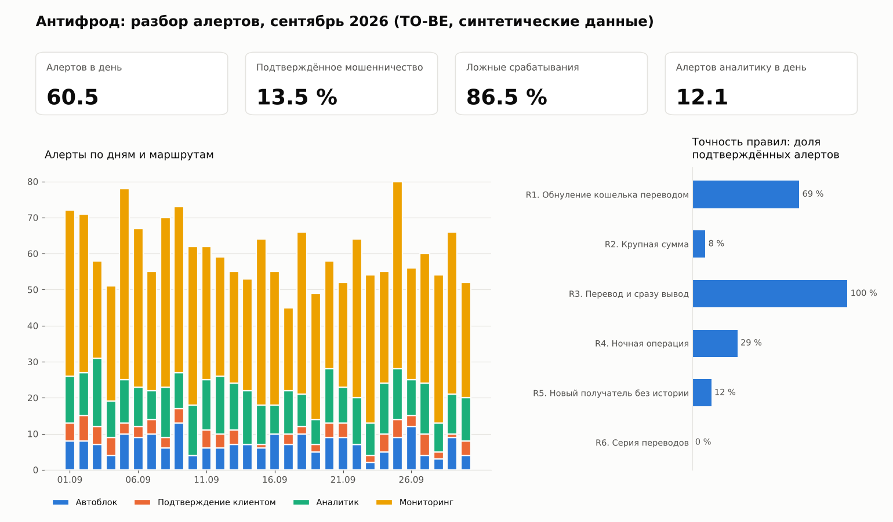
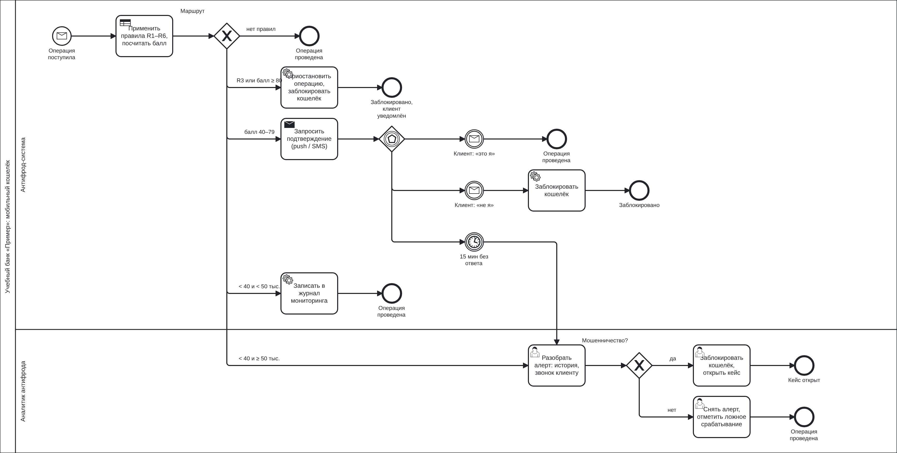
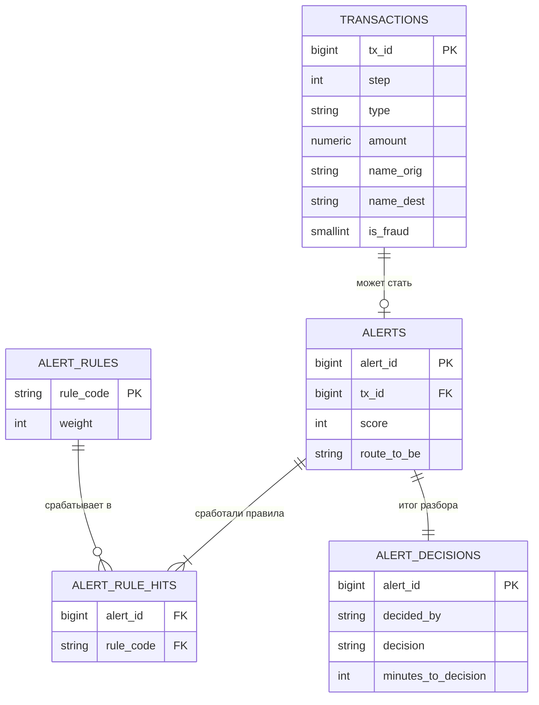

# Разбор антифрод-алертов: триаж и метрики процесса

> **Учебный проект.** Банк «Пример» вымышленный, данные синтетические (в формате открытого набора PaySim), внедрения не было.
> Роль: бизнес-аналитик. Мини-кейс: правила + процесс + метрики. Как сделано и где помогал ИИ — в разделе «Как сделано».

**За 30 секунд.** В мобильном кошельке шесть антифрод-правил дают ~60 алертов в день, и **86,5 %** из них ложные. Сейчас каждый алерт разбирает аналитик: работы на 12,1 часа при 12-часовой смене, медиана до решения — **5,3 часа**, и деньги успевают вывести: остановлено только **23 из 140** мошеннических схем. Я проверил каждое правило на данных (точность и полнота), нашёл одно бесполезное (R6, 0 подтверждений) и одно очень шумное (R2, 8,5 %), спроектировал триаж «автоблок / подтверждение клиентом / аналитик / мониторинг» и метрики для дашборда. По модели нагрузка на аналитика падает на **80 %**, а ошибочно блокируются **0,25 операции на 1 000**.

**Главные артефакты:** [Каталог правил и триаж](docs/rules_catalog.md) · [BPMN триажа](bpmn/alert-triage.png) · [SQL-метрики](sql/) · [Макет дашборда](dashboard/dashboard-mockup.png)



## Навигация
| Раздел | Где |
|---|---|
| Каталог правил R1–R6, таблица триажа, допущения | [docs/rules_catalog.md](docs/rules_catalog.md) |
| Процесс триажа (BPMN) | [bpmn/alert-triage.bpmn](bpmn/alert-triage.bpmn) |
| Модель данных | ниже и [data/ddl.sql](data/ddl.sql) |
| Применение правил и маршрутизация | [sql/00_build_alerts.sql](sql/00_build_alerts.sql) |
| Метрики | [sql/01…06](sql/) |
| Дашборд DataLens: требования и инструкция, данные | [docs/dashboard.md](docs/dashboard.md), [dashboard/](dashboard/) |
| Данные и их происхождение | [data/SOURCES.md](data/SOURCES.md) |
| Гайд защиты (для себя) | [DEFENSE.md](DEFENSE.md) |

## Процесс: что меняется
| | AS-IS | TO-BE |
|---|---|---|
| Кто разбирает | аналитик — все алерты | система, клиент, аналитик — по баллу |
| Операция во время проверки | уже прошла | при высоком балле приостановлена |
| Ночью | алерты ждут утра | автоблок и запрос клиенту работают 24/7 |
| Шумные правила | работают годами | бэктест раз в месяц, R6 отключаем, R2 переделываем |



## Модель данных

Алерт — это операция, а не срабатывание правила: если сработали три правила, алерт один, а правил в `alert_rule_hits` три. Так аналитик не разбирает одну операцию трижды.

## Метрики
Данные: 44 557 операций за 30 дней, 304 мошеннические (140 схем «перевод жертвы → вывод дропом» на 10,37 млн ₽).

| Запрос | Бизнес-вопрос | Результат |
|---|---|---|
| [01_rule_backtest](sql/01_rule_backtest.sql) | Какие правила полезны, а какие шумят? | R3 — 100 % точность; R2 — 8,5 %; R5 — 12,4 % при 1 133 алертах; R6 — 0 подтверждений |
| [02_as_is_queue](sql/02_as_is_queue.sql) | Почему аналитики «тонут»? | 60,5 алерта в день, загрузка 101 %, медиана 319 мин до решения, p90 — 12,8 ч; потеряно 8,63 млн ₽ |
| [03_to_be_triage](sql/03_to_be_triage.sql) | Что даёт триаж? | работа аналитика 12,1 → 2,4 ч в день (−80 %), точность автоблока 94,9 % |
| [04_fraud_case_coverage](sql/04_fraud_case_coverage.sql) | Сколько схем остановлено? | 136 из 140 (130 на переводе, 6 на выводе), пропущено 4 на 0,12 млн ₽ |
| [05_daily_metrics](sql/05_daily_metrics.sql) | Как процесс выглядит по дням? | источник для дашборда |
| [06_customer_friction](sql/06_customer_friction.sql) | Сколько честных клиентов беспокоим? | 2,04 SMS-запроса и 0,25 ошибочной блокировки на 1 000 операций |

**Главная метрика процесса** — не «сколько алертов», а **доля мошеннических денег, остановленных до вывода**, в паре с **ошибочными блокировками на 1 000 операций**. Первая без второй толкает «блокировать всех».

> Цифры TO-BE — результат модели с допущениями из [каталога](docs/rules_catalog.md#3-допущения-модели) на синтетике. Они показывают порядок эффекта, а не прогноз для реального банка.

## Как сделано
- Черновик собран как учебный проект вместе с ИИ-ассистентом (Claude): генератор данных, первые версии SQL и документов, ревью.
- Что я разобрал и переписал сам — в [DEFENSE.md](DEFENSE.md), раздел «Как сделано».
- Инструменты: PostgreSQL 16, Python 3 (генератор без внешних библиотек; макет дашборда — matplotlib), Yandex DataLens (по инструкции), Camunda Modeler / bpmn-js, Mermaid.

### Как запустить
```bash
createdb m5
psql -d m5 -f data/ddl.sql
python data/generate_data.py          # пересоздаёт data/transactions.csv (seed фиксирован)
psql -d m5 -f data/load.sql           # запускать из корня репозитория
psql -d m5 -f sql/00_build_alerts.sql # правила → алерты → маршрут → итог
for f in sql/0[1-6]*.sql; do psql -d m5 -f "$f"; done
psql -d m5 -f dashboard/export.sql && python dashboard/mockup.py   # CSV для DataLens и макет
```

## Источники
Синтетика в формате PaySim — подробности и как прогнать на настоящем наборе в [data/SOURCES.md](data/SOURCES.md).

---
## English summary
Learning project (fictional bank, synthetic PaySim-format data). Six anti-fraud rules in a mobile wallet produce about 60 alerts a day, 86.5% of them false positives; one analyst reviews every alert after the transaction has already gone through, so the median time to decision is 5.3 hours and only 23 of 140 fraud schemes are stopped before the money is cashed out. I backtested each rule in PostgreSQL (precision, recall, unique contribution), found a useless rule and a very noisy one, and designed a triage process in BPMN: auto-block, customer confirmation, analyst review or monitoring, based on a risk score. In the model, analyst workload drops by 80% while wrongful blocks stay at 0.25 per 1,000 transactions. Process metrics are exported for a Yandex DataLens dashboard (mock-up and build guide included).
