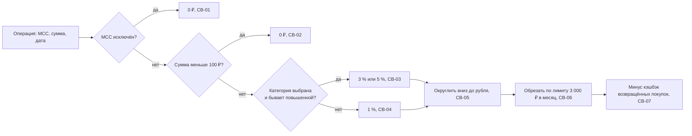
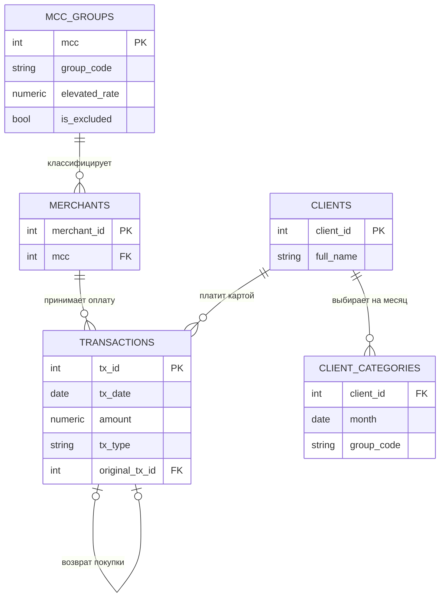

# Кэшбэк по категориям MCC: правила, стоимость, жалобы

> **Учебный проект.** Банк «Пример» и его клиенты вымышленные, данные синтетические (pandas + Faker), внедрения не было.
> Роль: бизнес-аналитик. Мини-кейс: правила + тестовые данные + SQL. Как сделано и где помогал ИИ — в разделе «Как сделано».

**За 30 секунд.** Программа кэшбэка стоит **≈1,13 млн ₽ в месяц** при бюджете 0,95 млн (**+19 %**) и дороже дохода от интерчейнджа, а клиенты жалуются на «неначисления». Я формализовал правила (9 правил, таблица решений DMN с автотестами), сгенерировал 109 тыс. операций 1 200 клиентов и посчитал на SQL: **62 % расходов** дают «Супермаркеты» и «АЗС», а клиенты, которые выбирают категории по своим тратам, обходятся на 43 % дороже (1,71 % против 1,20 % оборота). Сценарий «АЗС 3 % + супермаркеты без повышенной ставки» возвращает программу **на 10 % ниже бюджета**. Жалобы почти все объяснимы: исключённые MCC, покупки до 100 ₽, лимит и 8 кафе в гипермаркетах с MCC супермаркета.

**Главные артефакты:** [Правила и истории](docs/rules.md) · [DMN](bpmn/cashback-rate.dmn) + [тесты](tests/test_rules.py) · [Генератор](data/generate_data.py) · [SQL](sql/)

## Навигация
| Раздел | Где |
|---|---|
| Контекст, что такое MCC, правила CB-01…09, истории, edge cases | [docs/rules.md](docs/rules.md) |
| Таблица решений (2 решения: MCC → группа → ставка) | [bpmn/cashback-rate.dmn](bpmn/cashback-rate.dmn) |
| Проверка DMN тестами (мини-исполнитель DMN) | [tests/test_rules.py](tests/test_rules.py), [tools/dmn_eval.py](tools/dmn_eval.py) |
| Генератор тестовых данных (pandas, Faker, фиксированный seed) | [data/generate_data.py](data/generate_data.py) |
| Схема БД | ниже и [data/ddl.sql](data/ddl.sql) |
| Расчёт кэшбэка и аналитика | [sql/](sql/) |
| Гайд защиты (для себя) | [DEFENSE.md](DEFENSE.md) |

## Как считается кэшбэк

Ставку (левая часть) решает DMN, лимит и возвраты (правая) — шаг расчёта в SQL: им нужна сумма за месяц.

## Данные

Параметры программы (ставки, лимит, бюджет) лежат в таблице `program_params`: продукт меняет их чаще, чем правила.

Данные: 1 200 клиентов, 248 магазинов, 108 902 операции (из них 1 278 возвратов) за август–октябрь 2026, оборот 226 млн ₽.

## Результаты
| Запрос | Бизнес-вопрос | Результат |
|---|---|---|
| [01_cashback_calc](sql/01_cashback_calc.sql) | Сколько стоит программа? (создаёт представления для остальных) | 1,13–1,14 млн ₽ в месяц, 1,50 % оборота |
| [02_cost_by_category](sql/02_cost_by_category.sql) | На что уходит кэшбэк, сколько сверх бюджета? | супермаркеты 31,7 %, АЗС 29,9 % расходов; +18–20 % к бюджету; при интерчейндже 1,2 % программа в минусе ≈0,23 млн ₽ в месяц |
| [03_cap_and_choosers](sql/03_cap_and_choosers.sql) | Кто «съедает» бюджет? | в лимит упираются 5,3 % клиенто-месяцев, они дают 16,5 % расходов; «умный» выбор категорий — 1,71 % оборота против 1,20 % |
| [04_refunds](sql/04_refunds.sql) | Как возвраты влияют на кэшбэк? | списано 71 тыс. ₽ за 1 278 возвратов, 327 возвратов — в следующем месяце, 6 клиенто-месяцев ушли бы в минус (CB-08) |
| [05_scenarios](sql/05_scenarios.sql) | Как вернуться в бюджет? | лимит 2 000 ₽: +11 %; АЗС 3 %: +11 %; без повышенных супермаркетов: +1 %; **АЗС 3 % + супермаркеты 1 %: −10 %** |
| [06_why_no_cashback](sql/06_why_no_cashback.sql) | Почему «не начислили»? | 10 110 покупок с исключённым MCC, 3 278 до 100 ₽, 2 931 после исчерпания лимита; 8 кафе с MCC 5411 — 1 908 покупок, 790 из них у клиентов, выбравших «Кафе» |

**Рекомендация.** Сценарий S5 (АЗС 3 %, супермаркеты убрать из повышенных) экономит ≈300 тыс. ₽ в месяц. Риск — отток «водителей», поэтому сначала A/B-тест на 10 % новых клиентов. Для жалоб: показывать в приложении причину нулевого кэшбэка (US-02) и вести список исключений по ID магазина для кафе с «чужим» MCC (CR-2 в гайде защиты).

## Как сделано
- Черновик собран как учебный проект вместе с ИИ-ассистентом (Claude): генератор данных, первые версии SQL и документов, мини-исполнитель DMN, ревью.
- Что я разобрал и переписал сам — в [DEFENSE.md](DEFENSE.md), раздел «Как сделано».
- Инструменты: Python 3 (pandas, Faker), PostgreSQL 16, Camunda Modeler (DMN), Mermaid.

### Как запустить
```bash
pip install pandas faker
python data/generate_data.py          # ~1 минута, seed фиксирован — данные те же
python tests/test_rules.py            # DMN = справочник MCC
createdb m6
psql -d m6 -f data/ddl.sql
psql -d m6 -f data/load.sql           # запускать из корня репозитория
psql -d m6 -f sql/01_cashback_calc.sql   # сначала он: создаёт представления
for f in sql/0[2-6]*.sql; do psql -d m6 -f "$f"; done
```
`.dmn` открывается в [Camunda Modeler](https://camunda.com/download/modeler/) или на [demo.bpmn.io/dmn](https://demo.bpmn.io/dmn).

## Источники
Данные синтетические. Имена клиентов и магазинов сгенерированы Faker (ru_RU), совпадения случайны. Список MCC — общеизвестные коды категорий, перечни исключений у реальных банков отличаются.

---
## English summary
Learning project (fictional bank, synthetic data generated with pandas and Faker). A debit card cashback program costs about 1.13M RUB a month against a 0.95M budget and exceeds the bank's interchange income, while customers complain about missing cashback. I specified nine cashback rules, encoded the rate logic as a two-step DMN decision table (MCC → category → rate) covered by automated tests, generated 109k card transactions for 1,200 customers and analysed them in PostgreSQL with window functions for the monthly cap. Supermarkets and fuel account for 62% of the cost, and customers who pick bonus categories by their own spending cost 43% more. A what-if query compares five parameter scenarios; lowering fuel to 3% and removing supermarkets from bonus categories brings the program 10% under budget. Most complaints trace back to excluded MCCs, purchases under 100 RUB, the cap and cafés coded as supermarkets by their acquirer.
