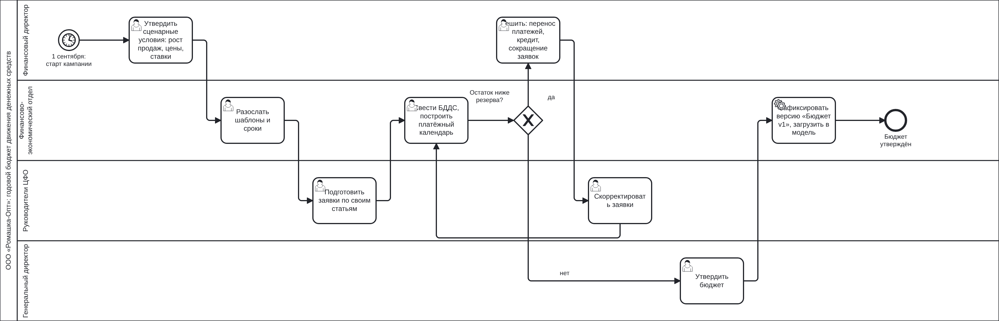

# БДДС и платёжный календарь в Excel

> **Учебный проект.** Компания ООО «Ромашка-Опт» вымышленная, данные синтетические, внедрения не было.
> Роль: бизнес-аналитик. Мини-кейс: модель данных + Excel на живых формулах + требования к отчёту. Как сделано и где помогал ИИ — в разделе «Как сделано».

**За 30 секунд.** Компания узнаёт о нехватке денег, когда платёж уже не проходит. Я построил в Excel бюджет движения денежных средств (БДДС) с план-фактом по 6 ЦФО и 13 статьям, прогнозом на ноябрь–декабрь и недельным платёжным календарём. План-факт показал, что поступления отстают от плана всё сильнее (с −0,5 % в июле до −3,5 % в октябре), и чистый поток за 4 месяца вышел **1,48 млн ₽ вместо 3,77**. Помесячный прогноз выглядит спокойно, а недельный календарь находит **разрыв −0,34 млн ₽ в неделю 7–13 декабря**: второй платёж за погрузчик совпал с зарплатой. Перенос платежей приоритета 3 на две недели закрывает разрыв без кредита, овердрафт стоил бы ≈20 тыс. ₽.

**Главные артефакты:** [Excel-модель](model/cash_flow_budget.xlsx) · [Модель данных](docs/data_model.md) · [Требования к отчёту](docs/report_requirements.md) · [BPMN бюджетной кампании](bpmn/budget-campaign.png)

## Навигация
| Раздел | Где |
|---|---|
| Excel: справочники, план, факт, план-факт, БДДС, платёжный календарь, сценарии | [model/cash_flow_budget.xlsx](model/cash_flow_budget.xlsx) |
| Скрипт, который собирает книгу (данные + формулы) | [model/build_model.py](model/build_model.py) |
| Модель данных: ЦФО, статьи, версии, план, факт, плановые платежи | [docs/data_model.md](docs/data_model.md) |
| Требования к отчётам FR-01…09, правила, ежемесячный цикл | [docs/report_requirements.md](docs/report_requirements.md) |
| Процесс бюджетной кампании (BPMN) | [bpmn/budget-campaign.bpmn](bpmn/budget-campaign.bpmn) |
| Гайд защиты (для себя) | [DEFENSE.md](DEFENSE.md) |

## Как устроена книга
| Лист | Что внутри | Ключевые формулы |
|---|---|---|
| Справочники | ЦФО, 13 статей (направление, вид деятельности), версии, параметры | — (жёлтые ячейки — ввод) |
| План | Бюджет v1 длинной таблицей: версия × месяц × ЦФО × статья | INDEX/MATCH для названия статьи |
| Факт_операции | 223 операции по счёту за июль–октябрь | INDEX/MATCH, DATE(YEAR, MONTH, 1) |
| Платежи_план | 114 ожидаемых платежей на ноябрь–декабрь с приоритетом | WEEKDAY — понедельник недели |
| План_факт | План, факт, отклонение, % по статьям и месяцам | SUMIFS по версии, месяцу, статье; условное форматирование > 5 % |
| БДДС_прогноз | Факт + прогноз v2, остатки, потоки по видам деятельности | SUMIFS, IF для статуса |
| Платёжный_календарь | 9 недель: поступления, выбытия по приоритетам, остаток, статус | SUMIFS по неделе и приоритету |
| Сценарии | Разрыв, овердрафт, перенос платежей, излишек | MIN, MAX, COUNTIF, INDEX/MATCH |
| Сводная_ЦФО | Выбытия по ЦФО и месяцам | SUMIFS (задание: переделать в сводную таблицу) |

## Что показала модель
**План-факт, июль–октябрь (бюджет v1):**
| | План, млн ₽ | Факт, млн ₽ | Отклонение |
|---|---|---|---|
| Поступления | 89,92 | 88,34 | −1,58 (−1,8 %) |
| Выбытия | 86,15 | 86,86 | +0,71 (+0,8 %) |
| Чистый поток | 3,77 | 1,48 | −2,29 |

Отставание поступлений растёт каждый месяц: −0,5 %, −1 %, −2 %, −3,5 %. Это не «плохие продажи», а растущий срок оплаты покупателями — та же проблема, что в кейсе [M4 «Дебиторка и DSO»](../m4-receivables-dso/). Логистика в октябре +15 %, маркетинг стабильно недорасходован (−17,5 %).

**Платёжный календарь, ноябрь–декабрь (прогноз v2), остаток на конец недели, млн ₽:**
| 02.11 | 09.11 | 16.11 | 23.11 | 30.11 | **07.12** | 14.12 | 21.12 | 28.12 |
|---|---|---|---|---|---|---|---|---|
| 3,30 | 3,33 | 4,52 | 2,16 | 2,45 | **−0,34** | 1,21 | 2,68 | 1,43 |

Помесячный БДДС на конец ноября и декабря показывает +1,41 и +1,43 млн — «ниже резерва, но живём». Разрыв виден только по неделям: в неделю 7 декабря уходят 8,05 млн ₽, из них 2 млн — второй платёж за погрузчик (поставщик поднял цену с 2,6 до 4 млн и попросил 50 % предоплаты), плюс зарплата 10-го.

**Сценарии (лист «Сценарии»):**
| Вариант | Результат |
|---|---|
| А. Овердрафт на разрыв + резерв (2,34 млн ₽ на 2 недели под 22 %) | ≈19,8 тыс. ₽ процентов |
| Б. Перенести платежи приоритета 3 (погрузчик, маркетинг) на 2 недели | остаток в худшую неделю +1,79 млн ₽, разрыва нет |
| В. Излишек 2,52 млн ₽ в неделю 16 ноября на депозит на неделю под 14 % | ≈6,8 тыс. ₽ |

Рекомендация: договориться с поставщиком погрузчика о переносе второго платежа на 21 декабря (вариант Б), а овердрафт держать как запасной вариант. Ставки — допущения (жёлтые ячейки), депозитную нужно сверить с ключевой ставкой ЦБ на дату расчёта.



## Как сделано
- Черновик собран как учебный проект вместе с ИИ-ассистентом (Claude): скрипт сборки книги, синтетические данные, первые версии документов, ревью.
- Что я разобрал и переделал сам — в [DEFENSE.md](DEFENSE.md), раздел «Как сделано».
- Инструменты: Excel / LibreOffice Calc, Python 3 (openpyxl — только чтобы собрать книгу воспроизводимо), Camunda Modeler / bpmn-js, Mermaid.

### Как запустить
```bash
pip install openpyxl
python model/build_model.py         # пересобирает model/cash_flow_budget.xlsx (seed фиксирован)
```
Книгу можно просто открыть в Excel: формулы пересчитаются при открытии. Проверено пересчётом в LibreOffice Calc 24.2 — ошибок формул нет, строка «Проверка» на листе календаря равна 0.

## Источники
Данные синтетические ([build_model.py](model/build_model.py)), контрагенты вымышленные. Срок уплаты по ЕНП — 28-е число, перенос с выходного на рабочий день — общее правило НК РФ.

---
## English summary
Learning project (fictional wholesale company, synthetic data). The company discovers cash shortages only when a payment bounces. I built a cash flow budget (BDDS) in Excel with live formulas: plan vs actual for 6 cost centres and 13 cash flow items, a November–December reforecast and a weekly payment calendar with payment priorities. Plan vs actual shows customer receipts falling further behind plan every month (−0.5% in July to −3.5% in October), so the four-month net cash flow was 1.48M RUB instead of 3.77M. The monthly forecast looks fine, but the weekly calendar reveals a −0.34M RUB cash gap in the week of 7 December, when an equipment payment coincides with payroll. A scenario sheet compares an overdraft (about 20k RUB interest) with postponing priority-3 payments by two weeks, which closes the gap. The repository also includes the data model, report requirements and a BPMN model of the annual budgeting cycle.
