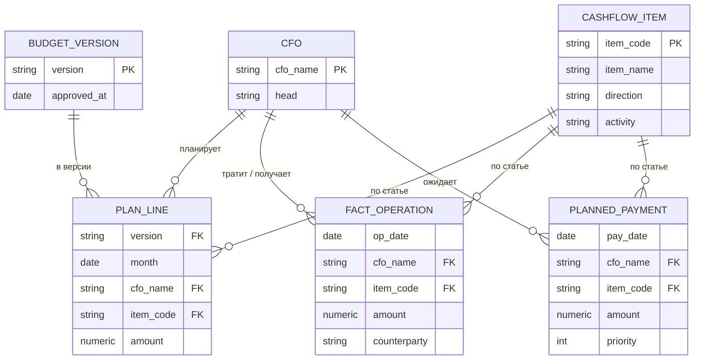

# Модель данных БДДС

Модель одинаково ложится и на Excel (листы книги), и на базу данных, если отчёт перерастёт Excel.

| Сущность | Лист книги | Зачем |
|---|---|---|
| ЦФО | Справочники, колонка A | Кто отвечает за статью и за отклонение |
| Статья БДДС | Справочники, C:F | Код, направление (поступление / выбытие), вид деятельности (операционная / инвестиционная / финансовая) |
| Версия бюджета | Справочники, H:I | «Бюджет v1» не меняется после утверждения; переоценки — новые версии, чтобы видеть, насколько ошибались |
| Строка плана | План | Длинная таблица версия × месяц × ЦФО × статья: её легко фильтровать и сводить |
| Фактическая операция | Факт_операции | Выгрузка из 1С или выписки; статья и ЦФО проставлены при разноске |
| Плановый платёж | Платежи_план | Ожидаемый платёж с датой и приоритетом — из него строится платёжный календарь |

**Почему план — длинная таблица, а не «месяцы в колонках».** Длинную таблицу можно дополнять новыми версиями и месяцами без перестройки формул, а сводная таблица и SUMIFS работают с ней напрямую. Матрица «статьи × месяцы» — это отчёт, а не хранение.

**Почему вид деятельности — атрибут статьи, а не операции.** Классификация «операционная / инвестиционная / финансовая» определяется смыслом статьи: покупка погрузчика всегда инвестиционная. Проценты по кредиту в этой модели отнесены к финансовой деятельности — это учётная политика компании, её надо согласовать с главным бухгалтером.
