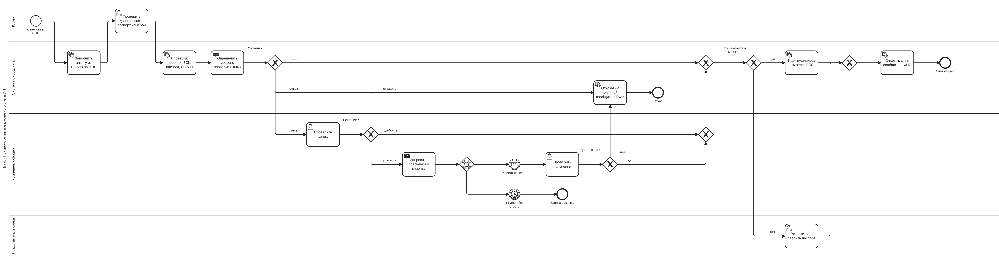
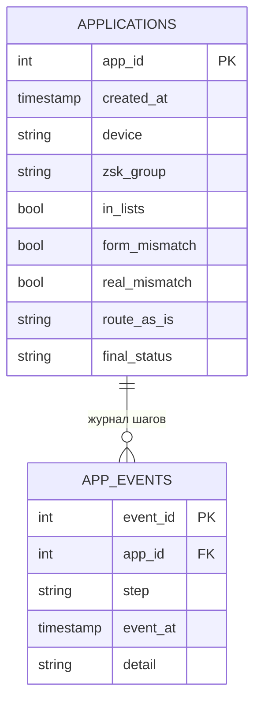

# KYC-онбординг ИП: где теряем клиентов и как сократить ручные проверки

> **Учебный проект.** Банк «Пример» и его клиенты вымышленные, данные синтетические, внедрения не было. Нормы 115-ФЗ упрощены для учебного кейса.
> Роль: бизнес-аналитик. Мини-кейс: регуляторные требования + процесс + таблица решений + KPI. Как сделано и где помогал ИИ — в разделе «Как сделано».

**За 30 секунд.** ИП открывает счёт онлайн, но до счёта доходят только **47 %** клиентов. Я разобрал журнал событий 4 000 заявок и нашёл три проблемы:
- **На шаге документов бросают 43 % клиентов с телефона** (с компьютера — 17 %). Фото слишком тяжёлые, а банк просит «свидетельство ОГРНИП», которого у новых ИП нет.
- **На ручную проверку уходит 47 % заявок**, и треть из них — из-за опечаток в анкете.
- **406 проверок клиентов «зелёной» группы ЗСК** не дали ни одного отказа и не могли дать: по 115-ФЗ таким клиентам отказать нельзя.

TO-BE: анкета заполняется из ЕГРИП, документы с телефона загружаются нормально, а уровень проверки определяет таблица решений DMN. Это даёт **31 % ручных проверок вместо 47 %** без роста риска. Если включить ещё и авто с постконтролем для новых ИП — 16 %, но рискованных клиентов со счётом станет больше, и это решение я оставил комплаенсу. Починка шага документов по оценке даёт **+27 % открытых счетов**.

**Главные артефакты:** [Требования и 115-ФЗ](docs/requirements.md) · [DMN](bpmn/kyc-check-level.dmn) + [тесты](tests/test_dmn.py) · [BPMN](bpmn/kyc-onboarding.png) · [KPI](docs/kpi.md) · [SQL](sql/)

## Навигация
| Раздел | Где |
|---|---|
| Контекст, что требует 115-ФЗ, AS-IS и TO-BE, правила KYC-01…10, истории US-01…05, состояния заявки | [docs/requirements.md](docs/requirements.md) |
| KPI с формулами, целями и сдерживающей метрикой | [docs/kpi.md](docs/kpi.md) |
| Процесс TO-BE: 4 дорожки, ручная проверка с запросом пояснений | [bpmn/kyc-onboarding.bpmn](bpmn/kyc-onboarding.bpmn) |
| Таблица решений «Уровень проверки» | [bpmn/kyc-check-level.dmn](bpmn/kyc-check-level.dmn) |
| Тесты DMN, включая перебор всех 192 комбинаций | [tests/test_dmn.py](tests/test_dmn.py) |
| Сравнение AS-IS и TO-BE на заявках | [tools/route_compare.py](tools/route_compare.py) |
| Диаграмма состояний заявки (PlantUML) | [uml/application-states.puml](uml/application-states.puml) |
| Генератор данных, схема, загрузка | [data/](data/) |
| Воронка, документы, ручная проверка, время, KPI, оценка эффекта | [sql/](sql/) |
| Гайд защиты (для себя) | [DEFENSE.md](DEFENSE.md) |

## Процесс TO-BE


## Данные

4 000 заявок и 23 073 события за август–октябрь 2026. Журнал событий устроен как в реальных системах онбординга: одна строка — один шаг, а воронку и время строим из событий, а не из готовых флагов.

## Результаты
| Запрос | Бизнес-вопрос | Результат |
|---|---|---|
| [01_funnel](sql/01_funnel.sql) | Где клиенты бросают заявку? | 4 000 → 3 524 анкеты → 2 289 с документами → 1 878 счетов (47,0 %); 63,5 % брошенных — на документах |
| [02_docs_dropoff](sql/02_docs_dropoff.sql) | Что чинить на шаге документов? | бросают 43,2 % с телефона против 17,4 % с компьютера; на телефоне 44 % ошибок — «файл слишком большой», на компьютере 64 % — нет свидетельства ОГРНИП; после 2 ошибок бросают 77,5 % |
| [03_manual_review](sql/03_manual_review.sql) | Какие ручные проверки ничего не меняют? | 46,6 % заявок на ручной проверке, 33,6 % из них — из-за опечаток; у зелёной группы 0 отказов из 406; 422 часа комплаенса за квартал |
| [04_time_to_account](sql/04_time_to_account.sql) | Почему счёт открывается дни, а не час? | медиана 55,4 ч; авто + ЕБС — 1 ч, ручная + встреча — 97,6 ч; очередь комплаенса — медиана 29 ч, в SLA 4 ч только 7,3 % |
| [05_monthly_kpi](sql/05_monthly_kpi.sql) | KPI по месяцам для дашборда | конверсия 46–48 %, ручные 44–49 % |
| [06_docs_fix_effect](sql/06_docs_fix_effect.sql) | Сколько даст починка документов? | ≈ +509 счетов за квартал (+27 %) при допущении «с телефона бросают как с компьютера» |
| [route_compare.py](tools/route_compare.py) | Что даст DMN? | ручных 46,6 % → 31,3 % (strict) → 15,7 % (с KYC-09); рискованных со счётом 25 → 25 → ≈ 42 |

**Рекомендация.** Внедрять сразу: анкету из ЕГРИП, исправленный шаг документов, ЕБС первой опцией и DMN без правила KYC-09. Новых ИП без группы ЗСК (KYC-09) переводить в авто только вместе с постконтролем (лимиты и мониторинг 30 дней) и после решения комплаенса. Сдерживающая метрика KPI-6 показывает, чего стоит каждый процент ручных проверок.

## Как сделано
- Черновик собран как учебный проект вместе с ИИ-ассистентом (Claude): генератор данных, первые версии SQL, DMN и документов, ревью.
- Что я разобрал и переделал сам — в [DEFENSE.md](DEFENSE.md), раздел «Как сделано».
- Инструменты: Python 3 (только стандартная библиотека), PostgreSQL 16, Camunda Modeler (BPMN, DMN), PlantUML, Mermaid.

### Как запустить
```bash
python data/generate_data.py          # seed фиксирован — данные те же
python tests/test_dmn.py              # тесты таблицы решений
python tools/route_compare.py         # AS-IS против TO-BE на заявках
createdb m8
psql -d m8 -f data/ddl.sql
psql -d m8 -f data/load.sql           # запускать из корня репозитория
for f in sql/0*.sql; do psql -d m8 -f "$f"; done
```
`.bpmn` и `.dmn` открываются в [Camunda Modeler](https://camunda.com/download/modeler/) или на [demo.bpmn.io](https://demo.bpmn.io), `.puml` — на [plantuml.com](https://www.plantuml.com/plantuml).

## Источники
- Федеральный закон № 115-ФЗ «О противодействии легализации (отмыванию) доходов…», ст. 7 и нормы о платформе «Знай своего клиента»; НК РФ, ст. 86.
- Платформа ЗСК и запрет отказывать клиентам с низким риском: [Сбербанк — «Светофор» ЦБ](https://www.sberbank.ru/ru/s_m_business/pro_business/svetofor_tsb), [Т-Банк — «Знай своего клиента»](https://secrets.tbank.ru/bezopasnost-biznesa/znaj-svoego-klienta/), [Контур](https://kontur.ru/articles/6514).
- Упрощённая идентификация — только для физлиц: [Большая российская энциклопедия](https://bigenc.ru), [КонсультантПлюс — идентификация при открытии счёта](https://www.consultant.ru/law/podborki/identifikaciya_klienta_pri_otkrytii_scheta/).
- Открытие счёта бизнесу с ЕБС: [ComNews, 2022](https://www.comnews.ru/digital-economy/content/223566/2022-12-16/2022-w50/alfa-bank-zapustil-otkrytie-scheta-dlya-biznesa-ispolzovaniem-edinoy-biometricheskoy-sistemy).
- Данные синтетические. ИНН сгенерированы с несуществующим кодом региона 00, совпадения с реальными исключены.

---
## English summary
Learning project (fictional bank, synthetic data) on online account opening for sole proprietors under Russia's AML law 115-FZ. An event log of 4,000 applications shows that only 47% end with an open account. Mobile users abandon at the document upload step 2.5 times more often than desktop users, and 47% of applications go to manual compliance review, a third of them only because of typos in a hand-typed form. I documented the regulatory requirements, modelled the TO-BE process in BPMN and moved routing into a ten-rule DMN decision table covered by tests that enumerate all 192 input combinations. Replaying the applications through the table cuts manual reviews to 31% with no increase in risky approvals; auto-approving new businesses under post-onboarding monitoring would reach 16%, but at a measurable risk cost that is tracked by a guardrail KPI. Fixing the document step is estimated to add about 27% more opened accounts.
