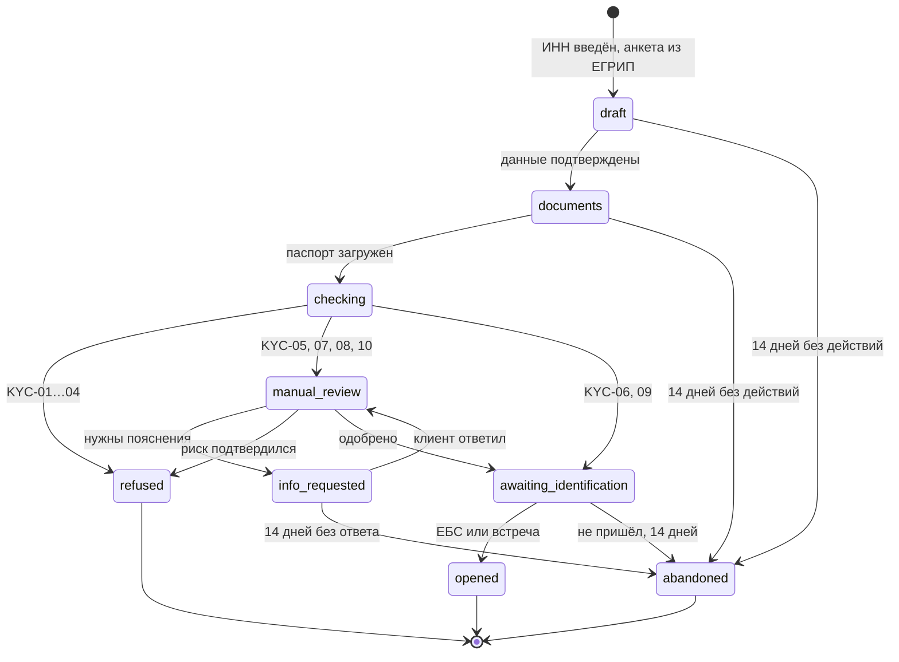

# Требования: онлайн-открытие счёта ИП (KYC по 115-ФЗ)

> Банк «Пример» вымышленный, данные синтетические. Нормы права приведены упрощённо, для учебного кейса; перед использованием в работе сверять с актуальной редакцией 115-ФЗ и нормативными актами Банка России.

## 1. Контекст и проблема
ИП открывает расчётный счёт онлайн: вводит данные, загружает документы, банк проверяет его и идентифицирует, после чего открывает счёт. За август–октябрь 2026 было 4 000 заявок, а счёт открыли только **47 %** клиентов. Теряем их в трёх местах:

| Где | Что видно в данных | Запрос |
|---|---|---|
| Документы | бросают 43,2 % клиентов с телефона и 17,4 % с компьютера; это 63,5 % всех брошенных заявок | `sql/02` |
| Ручная проверка | на ручную проверку уходит 46,6 % заявок; ожидание в очереди — медиана 29 ч, в SLA 4 ч укладывается 7,3 % | `sql/03`, `sql/04` |
| Идентификация | без ЕБС нужна встреча: медиана до счёта 47,8 ч против 1 ч через ЕБС | `sql/04` |

**Цель:** счёт открывается за час, если у клиента нет признаков риска. Доля ручных проверок падает, а рискованных клиентов, получивших счёт, не становится больше.

## 2. Что требует закон (кратко)
| Требование | Источник | Где в процессе |
|---|---|---|
| Идентифицировать клиента до приёма на обслуживание: ФИО, паспорт, ИНН, ОГРНИП, адрес | 115-ФЗ, ст. 7 | анкета из ЕГРИП, паспорт, встреча или ЕБС |
| Проверить клиента по перечню организаций и физлиц, причастных к экстремизму и терроризму, и по решениям МВК о замораживании | 115-ФЗ, ст. 7 | автопроверки, KYC-01 |
| Отказать в открытии счёта, если клиента нельзя идентифицировать, документы недействительны или клиент есть в перечне | 115-ФЗ, ст. 7 | KYC-01, KYC-02 |
| Учитывать группу риска платформы «Знай своего клиента» (ЗСК): клиенту с низким риском («зелёная» группа) нельзя отказать по основаниям 115-ФЗ, клиенту с высоким («красная») банк вправе отказать, а клиент может обжаловать отказ в межведомственной комиссии при Банке России | 115-ФЗ, нормы о платформе ЗСК; платформа работает с 1 июля 2022 года | KYC-04, KYC-06, KYC-07 |
| Сообщить в Росфинмониторинг об отказе в открытии счёта | 115-ФЗ, ст. 7 | задача «Отказать с причиной» |
| Сообщить в налоговую об открытии счёта ИП | НК РФ, ст. 86 | задача «Открыть счёт» |

**Важное уточнение.** Упрощённая идентификация по 115-ФЗ существует только для физических лиц: например, для небольших платежей. Индивидуального предпринимателя при открытии расчётного счёта банк идентифицирует полностью. Поэтому таблица решений здесь определяет **уровень проверки** (авто, ручная, отказ), а не выбирает «упрощённую» или «полную» идентификацию. Полная идентификация бывает либо через ЕБС, либо через встречу с представителем банка. Удалённое открытие счетов бизнеса с биометрией банки используют с 2022 года; условия для конкретного банка — в открытых вопросах.

## 3. Как работает сейчас (AS-IS)
1. Клиент вручную заполняет анкету из 25 полей.
2. Загружает паспорт (две страницы) и «свидетельство ОГРНИП». Новым ИП такого свидетельства не выдают с 2017 года, вместо него есть лист записи ЕГРИП, и банк может получить выписку сам.
3. Автопроверки работают по правилу маршрутизации AS-IS:
   - отказ, если клиент есть в перечне, паспорт недействителен, ИП прекратил деятельность или у клиента красная группа ЗСК;
   - иначе ручная проверка, если анкета не совпала с паспортом или ЕГРИП, ОКВЭД из списка внимания, а группа ЗСК жёлтая или ещё не присвоена;
   - иначе авто.
4. Комплаенс проверяет заявку в рабочие часы. Если что-то не сходится, запрашивает у клиента пояснения.
5. Клиента идентифицируют через ЕБС (если у него есть биометрия) или на встрече. После этого банк открывает счёт.

Что не так с этим правилом (`sql/03`):
- **33,6 % ручных проверок** вызваны опечатками в анкете: ё/е, формат адреса. Если анкету заполнять из ЕГРИП автоматически, этих расхождений не будет. Из 192 запросов пояснений по таким «ложным» расхождениям 31,8 % закончились тем, что клиент ушёл.
- **406 ручных проверок клиентов «зелёной» группы** не дали ни одного отказа и не могли дать: отказать им по 115-ФЗ нельзя. Эти проверки только задерживают открытие счёта.

## 4. Что меняем (TO-BE)
| # | Изменение | Что решает |
|---|---|---|
| C1 | Анкета заполняется из ЕГРИП по ИНН, клиент только подтверждает | пропадают ложные расхождения, клиенту меньше вводить |
| C2 | Документы: не просить свидетельство ОГРНИП, снимать паспорт камерой в рамке, сжимать фото до 2 МБ в приложении | меньше бросают на шаге документов (`sql/02`, `sql/06`) |
| C3 | Уровень проверки определяет таблица решений `bpmn/kyc-check-level.dmn` | ручная проверка только там, где она может что-то изменить |
| C4 | Первой предлагать идентификацию через ЕБС, встречу — запасным вариантом | счёт за час вместо двух дней |
| C5 | Постконтроль для KYC-09: лимит на операции и усиленный мониторинг 30 дней | новые ИП без группы ЗСК не стоят в очереди, а риск ловит мониторинг |

Процесс: `bpmn/kyc-onboarding.bpmn`. Состояния заявки: раздел 7 и `uml/application-states.puml`.

## 5. Правила: уровень проверки (DMN, hit policy FIRST)
Правила проверяются по порядку и срабатывает первое подходящее. Сначала идут отказы, которых требует закон, потом ручная проверка, потом авто.

| Правило | Условие | Уровень | Пример (тот же, что в `tests/test_dmn.py`) |
|---|---|---|---|
| KYC-01 | есть в перечне Росфинмониторинга или решении МВК | отказ | в перечне и в зелёной группе → отказ: перечень главнее |
| KYC-02 | паспорт недействителен | отказ | |
| KYC-03 | ИП прекратил деятельность по ЕГРИП | отказ | |
| KYC-04 | ЗСК: красная группа | отказ (клиенту — право обжаловать в МВК) | |
| KYC-05 | данные ЕГРИП не совпали с паспортом | ручная, запрос пояснений | расхождение у зелёной группы → всё равно ручная |
| KYC-06 | ЗСК: зелёная группа | авто | зелёная группа и ОКВЭД из списка внимания → авто |
| KYC-07 | ЗСК: жёлтая группа | ручная | |
| KYC-08 | группы ЗСК нет и ОКВЭД из списка внимания | ручная | |
| KYC-09 | группы ЗСК нет, ОКВЭД обычный | авто + постконтроль 30 дней | |
| KYC-10 | всё остальное (новое значение справочника) | ручная | `zskGroup = "unknown"` → ручная |

Почему порядок важен: клиент из перечня может одновременно быть в зелёной группе. Если бы KYC-06 стояло выше KYC-01, он бы получил счёт. Тест `test_all_combinations_are_safe` перебирает все 192 комбинации входов и проверяет, что стоп-факторы всегда ведут к отказу.

**Что даёт на данных** (`python tools/route_compare.py`, 2 289 заявок, дошедших до проверок):

| | AS-IS | TO-BE strict (без KYC-09) | TO-BE |
|---|---|---|---|
| Доля ручных проверок | 46,6 % | 31,3 % | 15,7 % |
| Часы комплаенса за 3 месяца | 422 | 283 | 142 |
| Рискованных получат счёт (оценка) | 25 | 25 | 41,9, из них 21 под постконтролем |

Рекомендация: внедрять сразу C1–C4 и DMN в варианте strict. Этот вариант срезает треть ручных проверок без какого-либо роста риска. KYC-09 включать только после того, как заработает постконтроль (C5). Решение по нему принимает комплаенс; в кейсе оно вынесено в открытые вопросы.

## 6. Пользовательские истории
**US-01. Анкета из ЕГРИП.** Как ИП, я хочу ввести только ИНН и увидеть свои данные уже заполненными, чтобы не набирать 25 полей с телефона.
```gherkin
Сценарий: данные подтягиваются по ИНН
  Дано ИП с ИНН, действующий по ЕГРИП
  Когда клиент вводит ИНН
  То ФИО, ОГРНИП, адрес и ОКВЭД заполнены из ЕГРИП и недоступны для правки
  И клиент может только подтвердить их или сообщить об ошибке в ЕГРИП
Сценарий: ИП прекратил деятельность
  Дано ИП со статусом «прекратил деятельность» в ЕГРИП
  Когда клиент вводит ИНН
  То заявка не создаётся, клиент видит причину (KYC-03)
```

**US-02. Фото паспорта с телефона.** Как ИП, я хочу снять паспорт камерой и сразу узнать, что фото подходит, чтобы не загружать его по три раза.
```gherkin
Сценарий: фото тяжелее лимита
  Дано фото паспорта размером 9 МБ
  Когда клиент делает снимок в приложении
  То приложение сжимает фото до 2 МБ или меньше до отправки
  И ошибка «файл слишком большой» не показывается
Сценарий: размытое фото
  Когда резкость кадра ниже порога
  То приложение просит переснять, не отправляя файл на сервер
```

**US-03. Уровень проверки.** Как комплаенс-офицер, я хочу получать на ручную проверку только заявки, где моё решение может что-то изменить, чтобы тратить время на реальный риск.
```gherkin
Сценарий: зелёная группа без расхождений
  Дано ЗСК «низкий риск», данные ЕГРИП совпадают с паспортом
  Когда система определяет уровень проверки
  То уровень «авто», правило KYC-06, заявка не попадает в очередь комплаенса
Сценарий: клиент в перечне
  Дано клиент найден в перечне Росфинмониторинга
  То уровень «отказ», правило KYC-01, независимо от группы ЗСК
```

**US-04. Запрос пояснений.** Как комплаенс-офицер, я хочу запросить у клиента пояснения в приложении и получить ответ в ту же заявку, чтобы не вести переписку по почте.
```gherkin
Сценарий: клиент не ответил
  Дано пояснения запрошены
  Когда прошло 14 дней без ответа
  То заявка переходит в статус «брошена», клиенту приходит уведомление
```

**US-05. Идентификация через ЕБС.** Как ИП с биометрией в ЕБС, я хочу пройти идентификацию в приложении, чтобы открыть счёт за час без встречи.
```gherkin
Сценарий: биометрия есть
  Дано заявка одобрена и у клиента есть подтверждённая биометрия в ЕБС
  Когда клиент проходит проверку по лицу и голосу в приложении
  То счёт открыт, реквизиты показаны клиенту
  И в ФНС отправлено сообщение об открытии счёта
Сценарий: биометрии нет
  То клиенту предлагается выбрать время встречи с представителем банка
```

## 7. Состояния заявки


## 8. Пограничные случаи
- **Клиент сменил паспорт, а в ЕГРИП ещё старый.** Это настоящее расхождение: правило KYC-05, ручная проверка, клиенту объясняем, как обновить сведения в ЕГРИП.
- **Группу ЗСК присвоили между заявкой и проверкой.** Берём группу на момент проверки и сохраняем её в заявке, чтобы решение можно было объяснить.
- **Повторная заявка после отказа.** Новая заявка, но с пометкой о прошлом отказе в карточке для комплаенса.
- **Красная группа обжалована в МВК.** После решения МВК группа меняется на платформе ЗСК, повторная заявка пройдёт по обычным правилам.

## 9. Открытые вопросы
1. Можно ли в нашем банке идентифицировать ИП через ЕБС без встречи? Какие условия и лимиты? Вопрос к юристам и комплаенсу.
2. Включать ли KYC-09 (авто с постконтролем)? Нужны лимиты постконтроля и согласие комплаенса.
3. Кто ведёт «список ОКВЭД повышенного внимания» и как часто его пересматривают?
4. Срок хранения фото паспорта и анкеты (115-ФЗ — не менее 5 лет после прекращения отношений), где их хранить.
