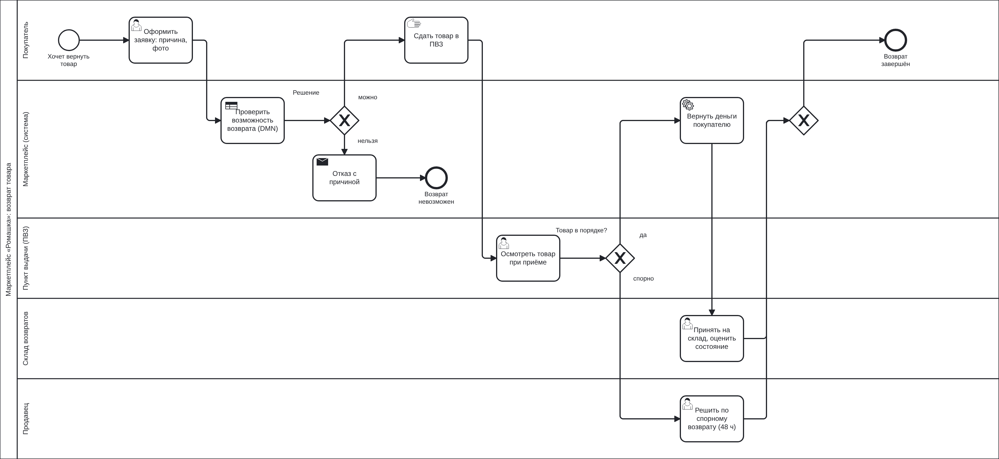

# Возврат товара на маркетплейсе: процесс, правила и SQL на схеме Olist

> **Учебный мини-кейс.** Маркетплейс «Ромашка» вымышленный, процесс — для российских правил возврата (учебная модель, не юридическая консультация). Для SQL взята **схема** открытого датасета Olist (бразильский маркетплейс, Kaggle, CC BY-NC-SA 4.0): в репозитории синтетическая выборка в этой схеме, настоящие данные загружаются скриптом.

**За 30 секунд.** Возвраты медленные и непрозрачные: покупатель не знает, примут ли товар, продавцы спорят, деньги приходят через недели. Я описал процесс между четырьмя участниками (покупатель, ПВЗ, склад, продавец), правила «можно ли вернуть» в DMN, состояния заявки и 4 SQL-запроса, которые на данных показывают, где рождаются возвраты: опоздания доставки и продавцы, поздно передающие товар.

## Артефакты
| Файл | Что |
|---|---|
| [bpmn/returns-to-be.bpmn](bpmn/returns-to-be.bpmn) | Процесс возврата, 5 дорожек |
| [bpmn/can-return.dmn](bpmn/can-return.dmn) | Можно ли вернуть: брак, ошибка продавца, «передумал» в течение 7 дней |
| [docs/requirements.md](docs/requirements.md) | Состояния заявки, истории, правила |
| [data/ddl_olist.sql](data/ddl_olist.sql), [data/load_real_olist.sql](data/load_real_olist.sql) | Схема Olist и загрузка настоящих CSV |
| [sql/](sql/) | 4 запроса |

## Что показывают запросы (на синтетической выборке, не на настоящем Olist)
| Запрос | Вопрос | Результат на выборке |
|---|---|---|
| [01](sql/01_late_delivery_by_state.sql) | Где чаще опаздывают? | Дальние штаты (CE, PE, BA) — 31–40 % опозданий против 3–6 % |
| [02](sql/02_late_vs_review.sql) | Опоздание → низкая оценка? | 63 % низких оценок у опоздавших против 7,6 % |
| [03](sql/03_seller_handover_delay.sql) | Кто виноват — продавец или логистика? | 6 продавцов всегда передают товар позже срока |
| [04](sql/04_return_candidates.sql) | Сколько вероятных возвратов? | 12,3 % доставленных заказов (прокси, см. ниже) |

**Допущение:** в Olist нет таблицы возвратов, поэтому «кандидат на возврат» — оценка 1–2 и (опоздание или жалоба на дефект/неполучение/не тот товар). Это прокси, а не факт возврата.

**Задание себе:** скачать настоящий датасет, загрузить `load_real_olist.sql`, прогнать запросы и заменить таблицу выше реальными цифрами.

## Ключевое решение
Ошибку продавца (не тот товар) возвращаем без осмотра и за счёт продавца — это самый частый и бесспорный случай, а осмотр в ПВЗ стоит дороже риска.

## Как сделано
Учебный проект с ИИ-ассистентом (Claude) как ревьюером и генератором синтетической выборки. Что я сделал сам — [DEFENSE.md](DEFENSE.md).

---
## English summary
Learning mini-project (fictional marketplace). I modelled a product return process across buyer, pickup point, returns warehouse and seller, captured return eligibility rules in DMN (Russian consumer law, simplified), defined return request states and wrote four SQL queries on the public Olist e-commerce schema showing that late deliveries and sellers who hand over late drive low reviews and likely returns. The repository ships a synthetic sample in the Olist schema; a loader script runs the same queries on the real dataset.
