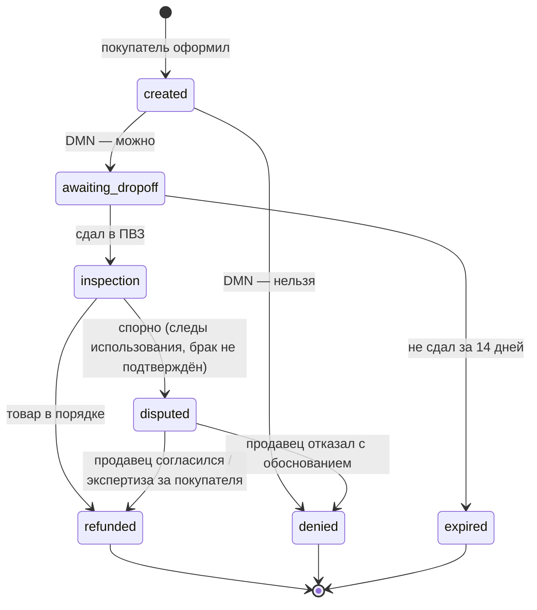

# Требования к процессу возврата

## Состояния заявки на возврат

## Истории
| ID | История | Критерии приёмки (кратко) |
|---|---|---|
| US-01 | Как покупатель, я хочу сразу узнать, можно ли вернуть товар, чтобы не ехать в ПВЗ зря | DMN отвечает в момент оформления; при отказе — понятная причина |
| US-02 | Как покупатель, я хочу получить деньги сразу после приёма в ПВЗ, если товар в порядке | Возврат денег запускается при статусе `refunded`, срок зачисления — по правилам способа оплаты |
| US-03 | Как сотрудник ПВЗ, я хочу чек-лист осмотра по категории товара | Чек-лист: товарный вид, комплект, ярлыки; фото обязательны при «спорно» |
| US-04 | Как продавец, я хочу решать спорные возвраты за 48 ч, чтобы не терять товар и рейтинг | Нет решения за 48 ч → решение в пользу покупателя |
| US-05 | Как маркетплейс, я хочу видеть, кто виноват в возвратах (продавец, логистика, качество) | Отчёт по причинам; SQL-прототипы `sql/01–04` |

## Бизнес-правила
- BR-01: Решение о возможности возврата — по `bpmn/can-return.dmn`.
- BR-02: Ошибка продавца (не тот товар, некомплект) — деньги без осмотра, обратная логистика за счёт продавца.
- BR-03: Срок сдачи в ПВЗ после одобрения — 14 дней, потом заявка `expired`.
- BR-04: Продавец отвечает по спорному возврату за 48 ч, молчание = согласие.
