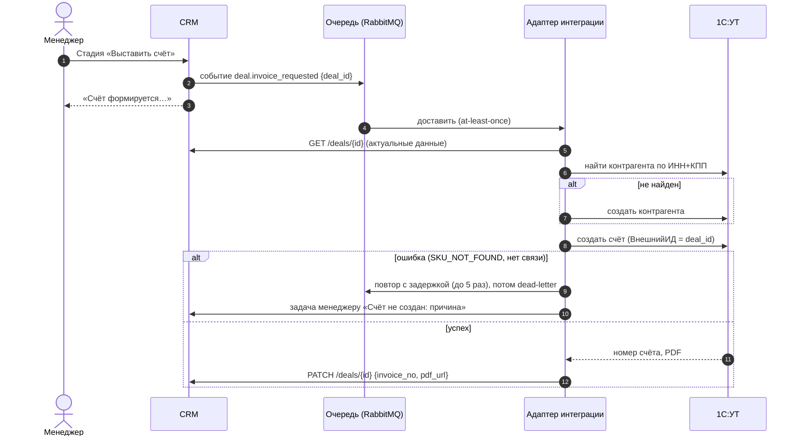
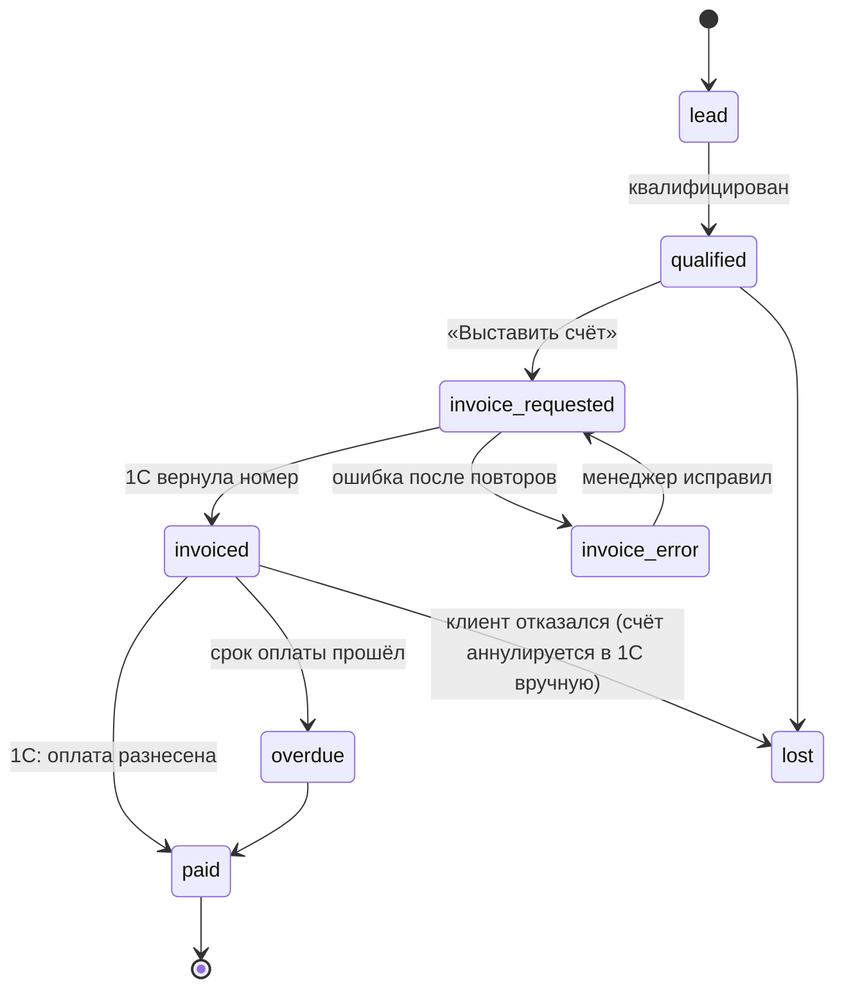

# Интеграция CRM ↔ 1С: от лида до счёта (спецификация)

> Учебный кейс в формате задачи с собеседования «опишите интеграцию CRM с ERP»: направление, объём, частота, источник истины, ошибки.

## 1. Контекст и проблема
Отдел продаж ООО «Ромашка-Опт» ведёт клиентов и сделки в CRM, а счета бухгалтерия выставляет в 1С:Управление торговлей. Менеджер копирует реквизиты клиента и состав сделки в письмо, бухгалтер вбивает их в 1С. Итог (учебные цифры со слов участников): ~15 минут на счёт, ошибки в реквизитах в каждом 10-м счёте, менеджер не видит, оплачен ли счёт, и звонит клиенту с напоминанием об уже оплаченном счёте.

**Цель:** счёт создаётся в 1С из сделки CRM без ручного ввода, статус оплаты виден в CRM.

## 2. Объём и направления
| Поток | Направление | Триггер | Частота / способ | Объём |
|---|---|---|---|---|
| Клиент (контрагент) | CRM → 1С | сделка перешла в «Выставить счёт», клиента ещё нет в 1С | событие, через очередь | ~150 новых в месяц |
| Счёт на оплату | CRM → 1С | стадия сделки «Выставить счёт» | событие, через очередь | ~600 в месяц |
| Номер и PDF счёта | 1С → CRM | счёт создан в 1С | событие | ~600 |
| Статус оплаты | 1С → CRM | поступление на расчётный счёт разнесено | событие | ~550 |
| Номенклатура и цены | 1С → CRM | изменение в 1С | раз в сутки, ночью, пакетом | ~3 000 позиций |

## 3. Источник истины по полям
| Данные | Мастер | Почему |
|---|---|---|
| Контакты, менеджер, стадия сделки | CRM | Работа продаж живёт там |
| Реквизиты юрлица (ИНН, КПП, банк, адрес) | **1С** после первичного создания | Там ведётся учёт, сверка с ФНС, документы |
| Номенклатура, цены, остатки | 1С | Учётная система |
| Номер счёта, сумма, НДС | 1С | Документ учёта |
| Статус оплаты | 1С (выписка банка) | Только учёт знает, что деньги пришли |

> Конфликт: менеджер исправил КПП в CRM, а в 1С старый. Правило: изменения реквизитов после создания — только в 1С, CRM получает их обратно; в CRM поле реквизитов только для чтения.

## 4. Маппинг полей «Сделка → Счёт на оплату»
| CRM | 1С | Правило / проверка |
|---|---|---|
| `company.inn` | Контрагент.ИНН | 10 или 12 цифр, контрольная сумма; поиск контрагента по ИНН+КПП |
| `company.kpp` | Контрагент.КПП | пусто у ИП |
| `company.name` | Контрагент.Наименование | только при создании нового |
| `deal.id` | Счёт.ВнешнийИД | ключ идемпотентности: повтор не создаёт второй счёт |
| `deal.products[].sku` | Номенклатура (по артикулу) | артикул не найден → ошибка `SKU_NOT_FOUND`, счёт не создаётся |
| `deal.products[].qty`, `price` | Строки счёта | цена из CRM, если ≤ прайса 1С; иначе нужна скидка с согласованием (вне рамок) |
| `deal.vat_rate` | Ставка НДС | 22 % / 10 % / без НДС |
| `deal.manager.email` | Счёт.Ответственный | по справочнику сотрудников; не найден → «по умолчанию» |
| `deal.payment_terms_days` | Счёт.СрокОплаты | дата счёта + дни |

## 5. Синхронно или через очередь

**Почему очередь, а не синхронный вызов:** 1С бывает недоступна (обновления, закрытие месяца); менеджеру не нужно ждать ответа 1С, ему нужно, чтобы счёт гарантированно создался. Очередь даёт повторы и не теряет события. **Минус:** счёт появляется не мгновенно (секунды–минуты), сообщения могут прийти повторно — поэтому `ВнешнийИД = deal_id` и проверка «счёт с таким ID уже есть».

Исходник PlantUML: `uml/invoice-flow.puml`.

## 6. Состояния сделки, которые важны интеграции

## 7. RACI
| Работа | Руков. продаж | Главбух | Менеджер | 1С-программист | Разработчик CRM | Аналитик |
|---|---|---|---|---|---|---|
| Утвердить маппинг и источник истины | C | **A** | I | C | C | R |
| Адаптер и очередь | I | I | – | R | R | C/**A** |
| Справочник артикулов (сверка CRM ↔ 1С) | A | C | I | R | R | C |
| Тестирование (UAT) | **A** | R | R | C | C | R |

## 8. Ошибки и edge cases
| Случай | Поведение |
|---|---|
| Дубль события | Счёт с `ВнешнийИД = deal_id` уже есть → вернуть его номер, второй не создавать |
| Контрагент есть в 1С с другим КПП (филиал) | Создать нового контрагента-филиал; ИНН совпадает, КПП разные — это нормально |
| Артикул удалён в 1С | `SKU_NOT_FOUND`, задача менеджеру, сделка → `invoice_error` |
| Менеджер изменил сделку после выставления счёта | Новый счёт не создаём автоматически; задача бухгалтеру «перевыставить» |
| 1С недоступна 2 часа | Сообщения ждут в очереди, после 5 повторов — dead-letter и алерт |

## 9. НФТ
Счёт создан ≤ 2 мин после смены стадии (p95); ни одно событие не теряется (очередь с подтверждением); журнал всех обменов 1 год; доступ адаптера к 1С — отдельный пользователь с минимальными правами.
